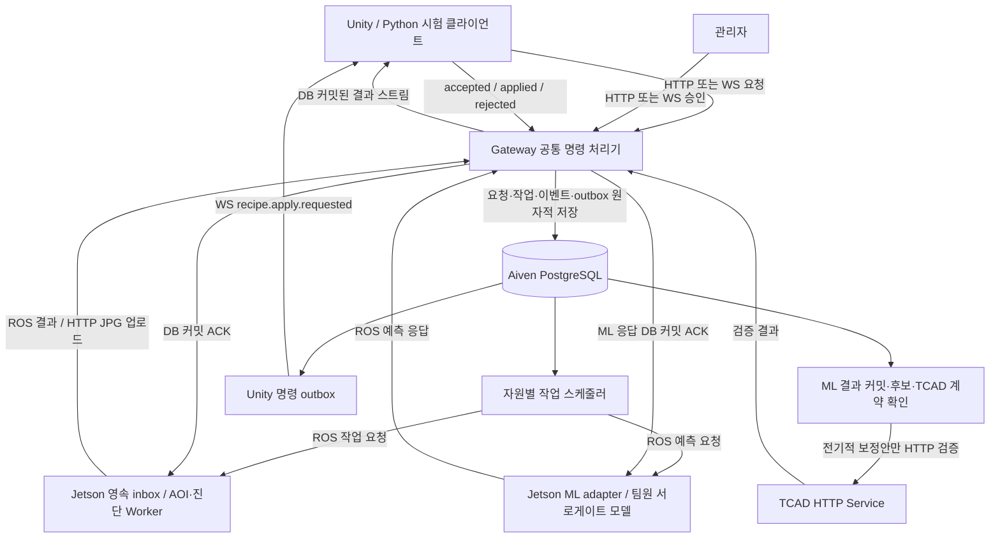

# 동시 공정 요청과 Unity 보정 적용 설계

기준일: 2026-10-16. 상태: 합의된 요구사항을 반영한 구현 대상 설계. 아래 신규 API·상태·DB 제약·env는 아직 구현/적용되지 않았다. Unity 앱 자체는 외부 개발 범위다.

## 1. 확정된 책임과 변경점

- AOI는 완성품 외관 검사만 수행한다. 제품을 잠시 정지시키고 안정화된 한 장을 확정하여 Jetson에서 두 모델에 동일한 전체 이미지를 입력한다. 원본/결과 JPG, 검출 목록과 실행별 임계값을 보존한다. AOI 불량으로 TCAD를 자동 호출하거나 공정값을 변경하지 않는다.
- 전기적 특성 이상에 대한 보정안은 별도 흐름이다. TCAD 검증 통과 후 관리자가 정확한 보정안 버전을 승인해야 한다.
- 승인 요청은 HTTP 또는 WebSocket으로 Gateway가 받는다. 승인된 값을 적용할 대상은 Unity의 가상 공정이다. 기존 문서의 Jetson 레시피 명령을 Unity 적용 완료로 간주하지 않는다.
- Gateway는 영속 상태·인가·전달을 담당하고 Jetson은 추론한다. Unity는 적용 명령을 검증하고 지정된 경계에서 적용한 뒤 결과를 회신한다.
- 전 공장을 하나의 순차 상태 머신으로 묶지 않는다. 서로 다른 제품/단계 작업은 동시에 접수할 수 있다. 같은 대상의 상태 변경만 순서를 통제한다.

## 2. 데이터 흐름

ML 책임 분리와 요청/응답 보존은 [Jetson ML 연계 계약](ml-integration-contract.md)을 따른다. GP 내부와 Id 측정 조건은 팀원 책임이며 Gateway는 전달·보존한다.



화살표는 병렬 가능한 경로이며 AOI → TCAD → 승인이라는 필수 순서가 아니다. HTTP/WS는 같은 처리기·인가·멱등성 규칙을 사용한다. 이미지는 HTTP로 보내고 ROS/WS에는 artifact 참조만 보낸다.

## 3. 요청 식별과 동시성 규칙

공통 필드: schema_version, request_id, run_id, lot_id, unit_id(개별 검사), stage_id, stage_attempt, expected_stage_version, correlation_id, payload. actor와 권한은 인증 세션에서 결정하고 본문이 주장하는 관리자 역할을 신뢰하지 않는다.

| 상황 | 처리 |
|---|---|
| 같은 request_id·같은 정규화 본문 | 기존 job/응답 반환. 새 촬영·추론·승인 생성 금지 |
| 같은 request_id·다른 본문 | HTTP 409 / WS conflict |
| 다른 request_id·같은 제품/단계/attempt 실행 중 | active_job_conflict와 기존 job_id 반환. 기존 작업 덮어쓰기 금지 |
| 다른 제품·독립 단계 | 각각 영속 접수 후 자원별 병렬 실행 또는 대기 |
| 동일 제품의 선행 단계 미완료 | prerequisites_not_met로 거절. 선행 완료 후 새 요청으로 재접수 |
| 재검사 | 기존 작업 종료 후 새 stage_attempt. 실행 중 재검사는 명시적 취소 완료 후 요청 |
| 오래된 stage version | 충돌 응답. 현재 상태 조회 후 새 요청 |
| 실행 중 timeout / 응답 유실 | 즉시 실패나 재촬영으로 간주하지 않음. lease·작업 조회·복구 정책 적용 |

단계 의존성은 recipe의 DAG로 정의한다. 독립 단계는 병렬로 실행하되 동일 제품에 대한 선행 조건은 지킨다. 도착 순서와 실제 공정 순서를 혼동하지 않는다.

DB에서 요청 키의 UNIQUE 제약과 활성 작업의 부분 UNIQUE 제약을 적용한다. 활성 범위는 (run_id, unit_id, stage_id)이며 lot 단위 작업은 별도 scope 키로 정규화해 NULL로 제약이 우회되지 않도록 한다. 상태 갱신은 version 비교 갱신과 필요한 행 잠금을 사용한다. 메모리 락만으로 중복을 막지 않는다.

네트워크 응답이나 추론을 기다리는 동안 DB 트랜잭션을 열어두지 않는다. 여러 Gateway/worker가 떠도 outbox 작업을 lease로 선점하고, 수신 측은 동일 command_id/job_id로 중복 실행을 방지한다.

## 4. 작업 실행·촬영·자원 경합

작업 실행 상태: queued → dispatched → accepted → running → succeeded / failed / cancelled / expired. 검사 판정(pass/fail/review)은 실행 상태와 분리한다. 불량을 발견한 검사는 실행 자체는 succeeded일 수 있다.

- GPU 추론은 Jetson당 초기 동시 실행 1개로 제한한다. 여러 요청 접수는 허용하되 영속 큐에서 대기한다. TCAD와 이미지 전송은 별도 자원 풀을 사용한다.
- 같은 카메라/검사 스테이션의 촬영은 직렬화한다. unit_id·정지 상태·정지 유효시간을 확인한다. 대기 중 제품이 이동했다면 새 제품을 이전 작업의 사진으로 찍지 않고 capture 실패로 처리한다.
- 카메라 스트림 수신은 계속하되, 요청 이후의 신선하고 품질 조건을 만족하는 한 장만 고정한다. 단순 sleep을 흔들림 제거 보장으로 취급하지 않는다.
- 촬영 완료와 검사 완료는 별도 이벤트다. 제품 이동은 공정 정책이 허용하는 시점에만 수행한다. 기본 시험에서는 최종 결과까지 정지 유지한다.
- 재전송은 같은 사진·같은 임계값·모델 버전을 사용한다. 의도적 재촬영은 새 attempt다.
- lease 재할당마다 fencing token을 증가시킨다. 이전 worker의 늦은 결과는 감사 기록에는 보존하되 최신 결과/단계 상태를 덮어쓰지 못한다. Jetson도 같은 job의 동시 실행을 막는다.
- 취소 요청은 즉시 취소 완료가 아니다. 실행 중 작업은 cancel_requested로 추적하며 worker 확인 전 자원 잠금을 풀지 않는다.
- 큐 크기와 대기 deadline을 제한한다. 포화 시 429/WS busy와 재시도 정보를 반환한다. 거절 요청도 감사 기록하되 DB 자체 장애 때는 저장 성공을 약속하지 않는다. 송신자가 동일 request_id를 보존·재시도해야 한다.

## 5. TCAD 검증 → 관리자 승인 → Unity 적용

보정안 상태와 적용 명령 상태를 분리한다.

```text
보정안: proposed → validating → validated → approved 또는 rejected
적용 명령: pending → sent → accepted → applied
                              └ rejected / reconciliation_required
```

1. TCAD 검증 기록은 proposal_id/version, 기준 recipe version, 정확한 x_candidate와 단위·해시, 검증 결과에 결속한다. 검증 실패/미완료는 승인 불가다.
2. 승인자는 proposal_id, proposal_version, validation_id, expected_recipe_version, 적용 대상 lot/경계를 지정한다. 승인 본문에서 새로운 임의 보정값을 주입할 수 없다.
3. Gateway는 관리자 권한·검증 통과·버전·범위·단위·허용값을 검사한다. 승인, 감사 이벤트, Unity 적용 outbox를 같은 DB 트랜잭션으로 커밋한다.
4. 동일 recipe 대상에 미완료 적용 명령은 하나만 허용한다. 두 관리자가 동시에 승인해도 하나만 성공한다. 경쟁하는 보정안은 conflict 처리하며 자동 최신값 덮어쓰기는 하지 않는다.
5. Unity에 command_id, proposal/version, validation_id, expected_recipe_version, new_recipe_version, target_lot_id, apply_at_boundary, 승인된 전체 설정값/단위/해시를 전달한다. Gateway DB에서 값을 구성한다.
6. Unity는 영속 inbox에 명령을 저장한 뒤 accepted를 보낸다. 지정 로트 시작 전 현재 버전을 비교하여 설정값을 하나의 원자적 변경으로 적용한다. 일부 값만 적용하지 않는다.
7. Unity는 command_id, 적용 recipe version/hash, 실제 적용 lot, applied_at을 회신한다. Gateway가 이를 검증·DB 커밋한 후에만 applied로 표시하고 회신 커밋 ACK를 보낸다.
8. Unity는 회신 커밋 ACK 전까지 결과를 재전송한다. 같은 명령이 다시 오면 재적용하지 않고 기존 결과를 반환한다.

‘다음 로트’는 수신 시점마다 달라지는 상대 표현으로 전송하지 않는다. 승인 시 미시작 상태인 정확한 lot_id와 경계를 고정한다. 그 로트가 이미 시작됐으면 늦은 적용을 거절하고 새 적용 대상 승인 절차로 보낸다. Gateway는 명령이 미확인인 동안 해당 로트 시작을 보류하며 Unity도 경계 검증을 수행해야 한다.

승인 이후 보정값 변경은 새 proposal version과 TCAD 재검증·재승인이 필요하다. 적용 timeout은 미적용의 증거가 아니다. 명령/현재 recipe 상태를 조회·재조정하고 reconciliation_required로 보류한다. 자동 롤백이나 새 command_id로 무조건 재적용하지 않는다.

이 보장은 외부 Unity 구현이 영속 중복 제거·버전 비교·경계 검증을 지킬 때 성립한다. 서버에서 WS send가 성공한 것만으로 적용을 보장할 수 없다.

## 6. 예정 통신 계약과 ACK

신규 이름은 구현 전 계약안이다. 기존 API와 경로 충돌을 확인한 뒤 적용한다.

| 목적 | HTTP | WebSocket |
|---|---|---|
| 검사 요청 | POST /api/v1/inspection-jobs | inspection.requested |
| 보정 승인 | POST /api/v1/correction-proposals/{id}/approvals | correction.approval.requested |
| 명령 상태 조회 | GET /api/v1/unity-commands/{command_id} | unity.command.status.requested |
| Unity 적용 결과 | POST /api/v1/unity-commands/{command_id}/results | recipe.apply.accepted / applied / rejected |

WS 제어 채널은 예정 /api/v1/control을 사용한다. 기존 /api/v1/stream은 DB 커밋 이벤트 재생용이며 수정 명령을 받는 채널로 암묵적으로 바꾸지 않는다. 명령은 인증된 대상 Unity 연결로 보내고 조회 API로 복구한다. 결과 이벤트는 sequence를 통해 재생·중복 제거한다.

ACK 의미: request.accepted=Gateway 영속 접수, inference.accepted=Jetson inbox 저장, /fab/event_acks committed=Aiven 이벤트 커밋, recipe.apply.accepted=Unity 명령 보관, recipe.apply.applied=Unity 실제 적용 보고, result.committed=Gateway가 적용 보고를 영속 저장함. 모든 ACK는 원본 ID를 포함한다.

운영에서는 인증된 HTTPS/WSS를 사용하고 승인 권한과 Unity 적용 결과 보고 권한을 분리한다. 같은 프로토콜로 들어온 모든 결과가 신뢰되는 것은 아니다.

## 7. DB 및 env 추가 계획

기존 테이블/마이그레이션을 조사해 중복 확장 없이 신규 migration으로 구현한다. 이 문서는 DDL 적용을 수행하지 않는다.

- 작업: scope_key, request hash, stage version, deadline, lease owner/expiry/fencing token, 모델·임계값 스냅샷.
- 보정안/검증: 불변 proposal version과 검증 입력 해시, 검증 결과·단위·기준 recipe.
- 승인: 승인자·시각·proposal/version·validation·대상 로트·기준 recipe version.
- Unity 명령/outbox: command_id UNIQUE, 대상 instance/recipe, payload hash, 상태·재시도·lease·deadline.
- 적용 결과/inbox: command_id 기준 중복 제거, 실제 recipe/version/hash/lot, 감사 이벤트.
- 승인과 명령 생성, 결과와 상태 변경은 각각 단일 DB 트랜잭션. 이미지 저장소와 DB는 별도이므로 artifact pending/ready 복구 규칙 유지.

예정 env: AOI_PART_CONF_THRESHOLD=0.35, AOI_DEFECT_CONF_THRESHOLD=0.20, AOI_PART_IOU_THRESHOLD=0.45, AOI_DEFECT_IOU_THRESHOLD=0.35, AOI_CAPTURE_POLICY=stable_snapshot, INFERENCE_MAX_CONCURRENCY=1, INFERENCE_QUEUE_CAPACITY, INFERENCE_JOB_TIMEOUT_SECONDS, UNITY_APPLY_ACK_TIMEOUT_SECONDS. 용량·timeout은 실측 후 지정하며 아직 앱이 읽는 설정이 아니다.

CAMERA_MODE/AOI_MODE/DIAGNOSIS_MODE/TCAD_MODE의 mock/prod를 독립적으로 관리한다. mock에서도 실제 HTTP/WS/ROS를 사용한다. Unity는 Python mock peer로 시험하고 추후 외부 Unity가 같은 계약을 구현한다. mock 결과에는 출처를 기록하며 prod 오류를 mock 성공으로 대체하지 않는다.

## 8. TDD 및 직접 시험 프로세스

아래는 구현할 합격 기준이다. 실행 명령을 제공하는 현재 통신 시험은 [기존 runbook](../runbooks/process-inspection-test.md)을 사용한다. 아래 신규 시나리오는 아직 실행 가능하다고 주장하지 않는다.

| 순서 | 먼저 실패시킬 테스트 | 합격 기준 |
|---|---|---|
| 1 | HTTP와 WS로 동일 요청 동시 제출 | job 1개, 같은 job_id. 다른 본문은 conflict |
| 2 | 같은 제품/단계에 서로 다른 요청 동시 제출 | 활성 job 1개. 나머지는 명시적 충돌 |
| 3 | 독립 제품/단계 10개 동시 제출 | 각 job 추적 가능, GPU 동시 실행 1개, 다른 자원은 진행 |
| 4 | 선행 미완료·카메라 점유·제품 이동·큐 포화 | 규정된 거절/대기/촬영 실패, 다른 제품 사진 혼입 없음 |
| 5 | 실행 중 worker 종료와 lease 재할당 | 중복 최종 결과 없음, 이전 fencing token 결과는 반영 금지 |
| 6 | 두 관리자 동시 승인·미검증 승인·값 변조 | 유효 승인/명령 1개, 미검증·변조 거절 |
| 7 | Unity applied 회신 유실 후 재전송 | 적용 1회, 재전송으로 DB 상태 복구 |
| 8 | Unity 재시작·이미 시작한 lot·recipe version 불일치 | 자동 오적용 없음, 충돌/재조정 기록 |
| 9 | AOI 불량과 전기적 진단 동시 요청 | AOI는 TCAD 호출 0회, 진단만 검증 조건에 따라 호출 |
| 10 | Aiven 단절·이미지 업로드 실패·WS 재접속 | 저장 전 성공 ACK 없음, outbox 보존, 재접속 후 결과 재생 |

시험 순서: 임시 DB 스키마 준비 → Gateway/ROS 브리지 → Jetson mock Worker → TCAD mock HTTP 서비스 → Python Unity mock peer → 위 병렬 시나리오 실행 → job/event/command ID로 DB·ACK·mock 적용 횟수 대조. mock peer는 수신 지연·중복·ACK 유실·재시작·적용 거절을 선택할 수 있어야 한다. 모드를 prod로 바꾸는 시험은 계약 시험 통과 뒤 서비스별로 수행한다.

## 관련 문서

- [전체 검사 아키텍처](process-inspection-orchestration.md)
- [기존 TDD 작업 목록](../plans/process-inspection-tdd-plan.md)

기존 문서와 충돌하면 동시성·Unity 적용 대상·완성품 AOI 범위는 이 문서를 우선한다. 실제 구현 상태는 별도이며 문서 갱신만으로 기존 Jetson 명령 경로가 변경되지는 않는다.
