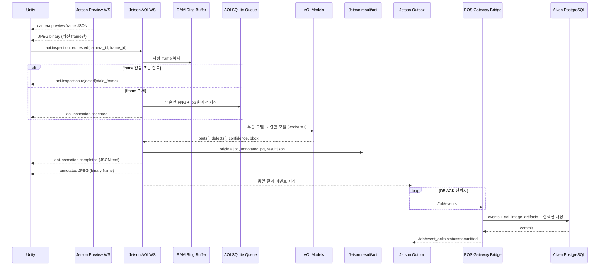
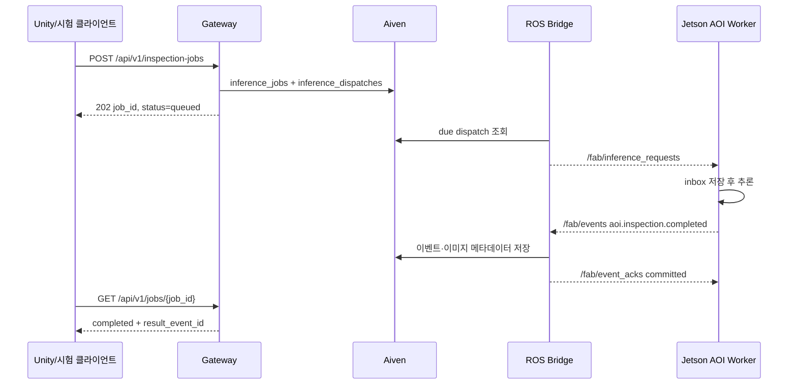
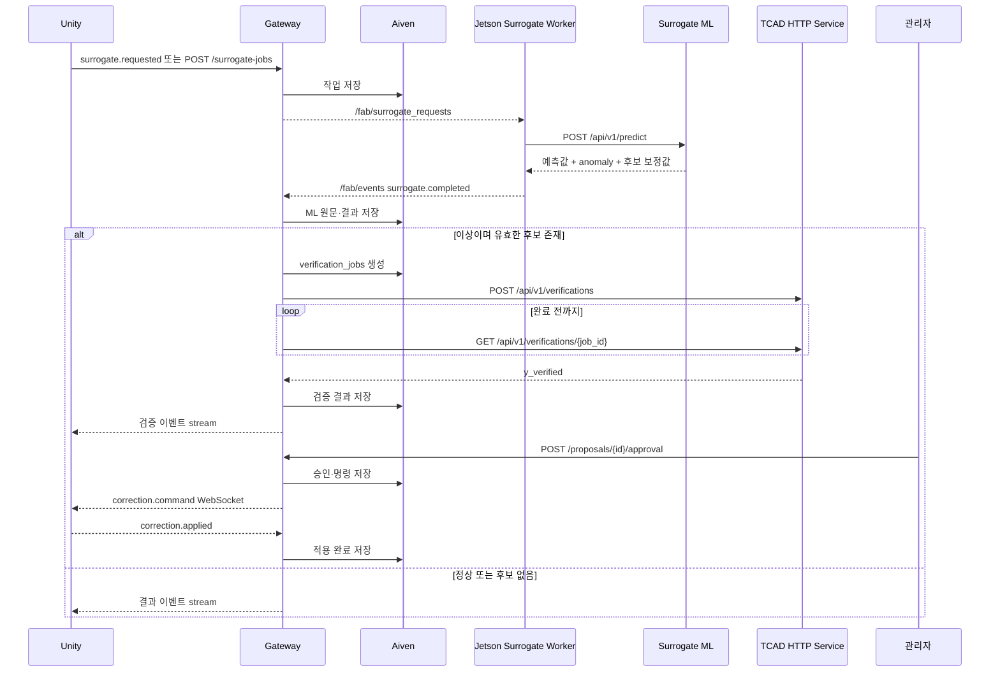

# Virtual Fab 현재 시스템 아키텍처

기준일: 2026-10-20

이 문서는 AOD4184A 기반 Virtual Fab의 현재 구현과 확정된 목표 연결 구조를 함께 설명한다. 그림에서 `구현`은 현재 저장소에 실행 코드가 있는 경로, `Mock`은 실제 외부 시스템 대신 시험 서버가 있는 경로, `연결 필요`는 계약은 확정됐지만 아직 코드가 완전히 이어지지 않은 경로다.

## 1. 핵심 원칙

- Unity의 AOI 검사 요청과 결과 이미지는 **Jetson AOI WebSocket 서버**로 직접 전달한다.
- Jetson은 IP 카메라를 한 번만 연결해 짧은 RAM Ring Buffer를 유지하며, Unity에는 저장 없는 저해상도 Preview만 보낸다.
- Unity의 AOI 요청은 Preview에서 본 `frame_id`를 지정한다. Jetson은 해당 원본 frame을 작업용 PNG로 먼저 고정한 뒤 비동기 추론한다.
- Gateway는 로컬 PC/WSL에서 실행하며 ROS 2 이벤트 구독, Aiven PostgreSQL 영구 저장, TCAD 요청, 승인 및 보정 명령을 담당한다.
- Jetson은 단순 ROS 구독자가 아니다. AOI WebSocket 서버인 동시에 ROS 요청 구독자·결과 발행자다.
- Unity는 목적이 다른 두 연결을 사용한다.
  - AOI 실시간 경로: `ws://<JETSON_IP>:8400/aoi`
  - 중앙 이벤트·승인·보정 경로: `ws://<GATEWAY_IP>:8000/api/v1/...`
- 이미지 원본과 박스가 표시된 JPG는 Jetson에 저장한다. Aiven에는 절대 경로, 파일명, SHA-256, 크기, 해상도와 탐지 결과를 저장한다.
- ROS 메시지는 at-least-once로 전달될 수 있다. `event_id` 멱등성과 `/fab/event_acks`를 이용해 중복을 안전하게 처리한다.
- 산화막 두께·바디 도즈 등 공정 보정은 TCAD 검증 후 관리자 승인 없이는 적용하지 않는다.
- 모든 보정은 가상 공정에만 적용한다. 물리 장비 제어는 범위 밖이다.

## 2. 전체 시스템 구성

```mermaid
flowchart LR
    subgraph UNITY[Unity PC]
        U[가상 Fab UI\nPreview 표시 + AOI 요청]
    end

    subgraph JETSON[Jetson Orin Nano]
        CAM[IP Camera Source\nmock 또는 HTTP(S)]
        BUF[(RAM Ring Buffer\n최근 2초 / 최대 128 MiB)]
        PWS[Preview WebSocket\n:8500/camera/preview]
        JWS[AOI WebSocket 서버\n:8400/aoi]
        QUEUE[(AOI durable queue\nSQLite + pinned PNG)]
        AOI[AOI 2단계 추론\n부품 + 결함]
        IMG[(result/aoi\n원본·annotated JPG)]
        AOUT[(AOI SQLite outbox)]
        AWORK[ROS AOI Worker]
        SWORK[ROS Surrogate Worker]
        CMD[ROS Command Subscriber]
        SML[간이 원인분석 ML\nMock 또는 실제 모델]
    end

    subgraph GATEWAY[로컬 PC / WSL Gateway]
        GHTTP[Gateway HTTP API\n:8000]
        GWS[Gateway WebSocket\ncontrol / stream / commands]
        ROS[ROS 2 Gateway Bridge]
        VERIFY[TCAD Verification Worker]
    end

    subgraph CLOUD[Aiven Cloud]
        PG[(PostgreSQL)]
    end

    subgraph TCAD[TCAD 워크스테이션]
        THTTP[TCAD HTTP Service]
        SILVACO[Silvaco TCAD]
    end

    CAM --> BUF
    BUF --> PWS
    PWS -->|최신 frame JSON + JPEG\n저장하지 않음| U
    U -->|camera_id + frame_id| JWS
    JWS -->|선택 frame 복사·영속 후 accepted| QUEUE
    QUEUE --> AOI
    AOI -->|completed JSON + annotated JPEG| U
    AOI --> IMG
    JWS -->|동일 AOI 결과 선저장| AOUT
    AOUT -->|/fab/events, ACK 전 재전송| ROS

    GHTTP -->|검사/ML 작업 접수| PG
    ROS -->|/fab/inference_requests| AWORK
    ROS -->|/fab/surrogate_requests| SWORK
    AWORK --> AOI
    SWORK --> SML
    AWORK -->|/fab/events| ROS
    SWORK -->|/fab/events| ROS
    ROS -->|트랜잭션 저장| PG
    ROS -->|/fab/event_acks| AWORK
    ROS -->|/fab/event_acks| SWORK

    VERIFY <-->|검증 생성/조회 HTTP| THTTP
    THTTP -.->|실제 adapter 예정| SILVACO
    VERIFY <--> PG

    U <-->|중앙 제어/이벤트/보정 WS| GWS
    GWS <--> PG
    ROS -->|/fab/commands| CMD
    CMD -->|correction.applied| ROS
```

직접 WebSocket 서버는 추론 결과를 Unity에 보내기 전에 SQLite outbox에 저장한다.
ROS 영속화가 활성화된 경우 동일 event를 `/fab/events`로 재발행하고 Gateway의
`/fab/event_acks`가 `committed` 또는 `dead_lettered`를 반환할 때까지 보존한다.

## 3. 컴포넌트 책임과 구현 상태

| 컴포넌트 | 위치 | 책임 | 상태 |
| --- | --- | --- | --- |
| Jetson Camera Capture | Jetson | 카메라 단일 연결, 재연결, RAM Ring Buffer 공급 | 구현 |
| Jetson Preview WebSocket | Jetson | Unity에 최신 frame만 JSON+JPEG로 전송 | 구현 |
| Jetson AOI WebSocket | Jetson | `frame_id` 검사 접수, durable queue, JSON+annotated JPG 반환 | 구현 |
| Jetson AOI Worker | Jetson | `/fab/inference_requests` 구독, AOI 추론, `/fab/events` 발행, ACK 처리 | 구현 |
| AOI 결과 영속 연결 | Jetson | 직접 WebSocket 결과를 SQLite outbox와 `/fab/events`로 연결 | 구현 |
| Surrogate Worker | Jetson | `/fab/surrogate_requests` 구독, 모델 HTTP 호출, 결과 이벤트 발행 | 구현 |
| 실제 Surrogate ML | Jetson | GP 계열 모델 예측 | 외부 팀 구현 예정 |
| Mock Surrogate | Jetson/WSL | 고정된 정상·이상·실패 응답 | Mock 구현 |
| ROS Gateway Bridge | WSL | 이벤트 저장, DB ACK, 작업·명령 발행 | 구현 |
| Event Gateway HTTP/WS | WSL | 작업 접수, 이벤트 재생, 승인, Unity 보정 전송 | 구현 |
| Aiven PostgreSQL | Cloud | 이벤트·작업·검증·승인·명령·이미지 메타데이터 영구 저장 | 적용 |
| Mock TCAD | WSL | 결정적 검증 응답과 장애 시나리오 | Mock 구현 |
| TCAD HTTP Service | TCAD 워크스테이션 | Silvaco adapter 경계 | 틀 구현, backend 미연결 |
| Unity 클라이언트 | Unity PC | AOI 직접 연결과 중앙 Gateway 연결 | 외부 팀 구현 예정 |

## 4. 카메라 Preview와 AOI 직접 검사 데이터 흐름



Unity가 결과 이미지를 받았다는 사실과 Aiven 저장 완료는 서로 다른 상태다. Unity 표시 성공은 직접 WebSocket 응답으로, 영구 저장 성공은 ROS ACK로 판단한다.

## 5. Gateway 접수형 AOI 흐름

중앙 Gateway에서 작업을 먼저 생성해야 하는 경우에는 다음 경로를 사용한다. 이 흐름은 현재 구현돼 있다.



이 경로는 직접 AOI 이미지 전송 경로를 대체하지 않는다. 이미지가 필요한 Unity 화면은 Jetson 직접 WebSocket을 사용한다.

## 6. 간이 ML → TCAD → 승인 → 보정 흐름



간이 ML의 내부 모델 구조는 담당 팀의 책임이다. 통합 계약은 입력 원문, 모델·계약 버전, 측정 조건, 출력값, 이상 판정, TCAD 후보를 원문 그대로 저장하는 데 집중한다.

## 7. 식별자와 동시성

| 필드 | 의미 | 멱등성 범위 |
| --- | --- | --- |
| `run_id` | 하나의 가상 Fab 실행 | 실행 전체 |
| `request_id` | 클라이언트 요청 | 동일 내용 재시도 |
| `job_id` | AOI 또는 Surrogate 작업 | 작업 처리 |
| `event_id` | 불변 이벤트 | DB 중복 저장 방지 |
| `proposal_id` | 보정 후보 | TCAD·승인 연결 |
| `command_id` | 승인 후 적용 명령 | Unity/Jetson 중복 적용 방지 |
| `sequence` | Aiven 저장 순서 | Unity event stream cursor |
| `attempt` | 같은 작업의 실행 시도 | 결과·파일 경로 구분 |

서로 다른 `run_id`, 장비, 공정 단계는 동시에 처리할 수 있다. 같은 `run_id + unit_id + stage_id`에 활성 작업이 이미 있으면 Gateway는 409를 반환한다. 동일 `request_id`와 동일 payload 재요청은 기존 작업을 반환하고, 내용이 달라지면 충돌로 거부한다.

## 8. 전송별 성공 기준

| 전송 | 성공 기준 | 재시도/보존 |
| --- | --- | --- |
| Unity → Jetson AOI WS | completed JSON 뒤 JPEG 무결성 확인 | 클라이언트가 같은 ID로 제한적 재시도 |
| Jetson → Gateway ROS event | `/fab/event_acks`의 `committed` | Jetson SQLite outbox 재발행 |
| Gateway → Aiven | DB 트랜잭션 commit | Gateway worker 재시도 |
| Gateway → TCAD HTTP | 요청 ID 일치 및 완료 결과 계약 검증 | verification job 재조회 |
| Gateway → Unity stream | `sequence` cursor 진전 | 재접속 시 `after_sequence` 재생 |
| Gateway → Unity command | `correction.applied` 및 `application.ack` | DB lease 기반 재전송 |
| Gateway → Jetson command | 서명된 명령과 `correction.applied` 이벤트 | DB command lease + Jetson 멱등 저장 |

## 9. 관련 명세

- HTTP: [`../api/openapi.yaml`](../api/openapi.yaml)
- WebSocket 및 ROS 2: [`../api/asyncapi.yaml`](../api/asyncapi.yaml)
- 사용 안내: [`../api/README.md`](../api/README.md)
