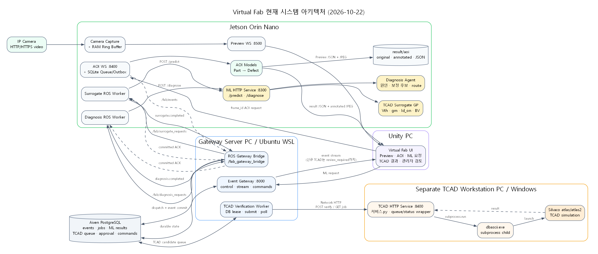
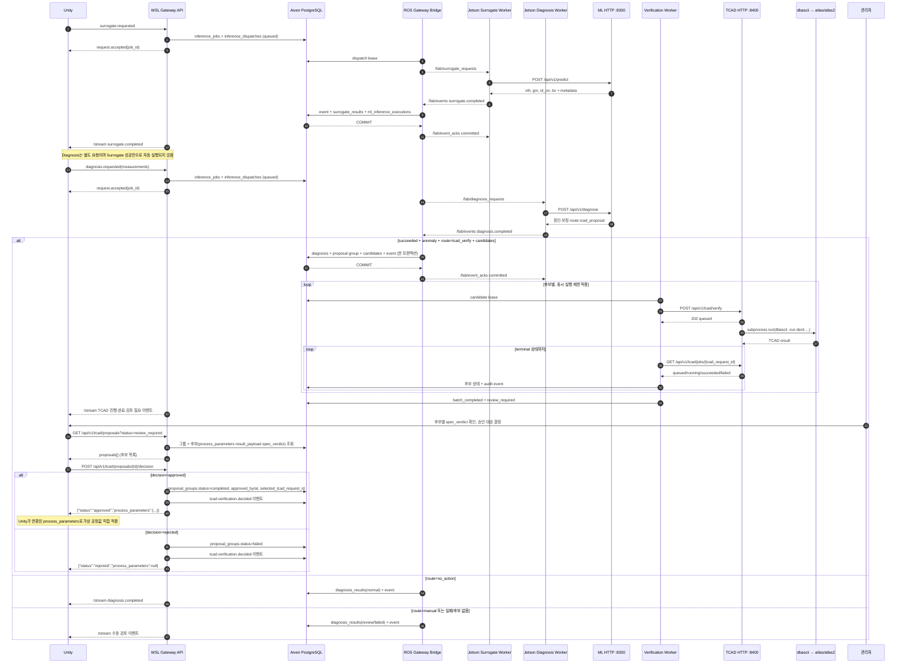
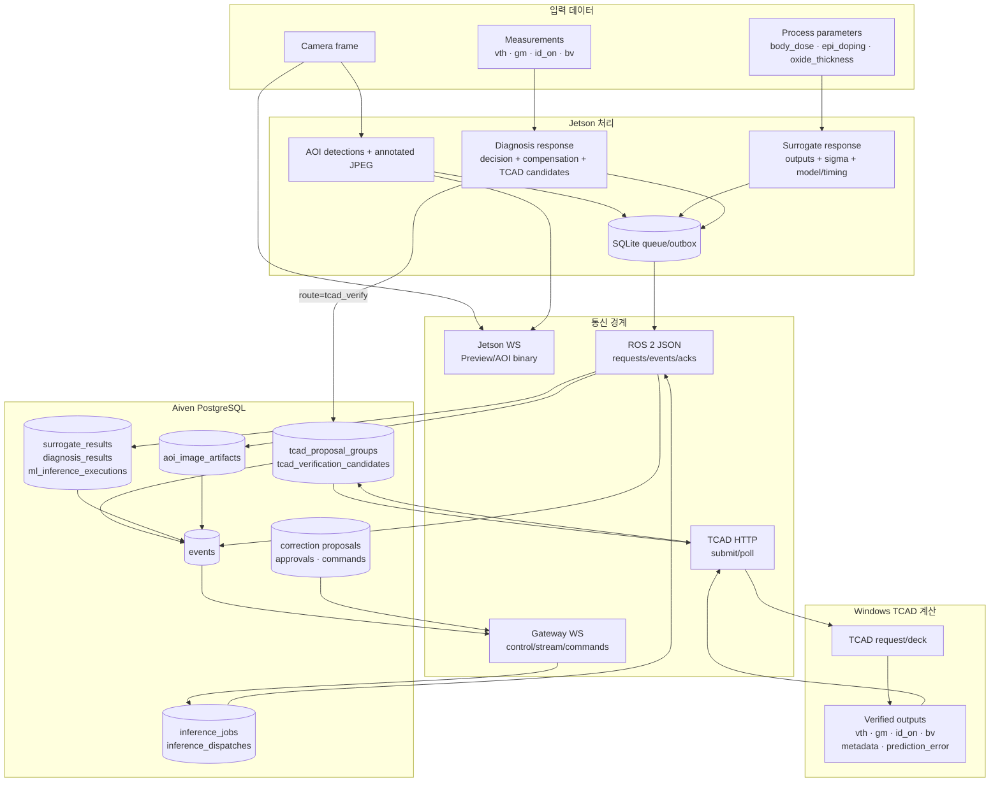

# Virtual Fab 현재 시스템 아키텍처

기준일: 2026-10-23

기준 저장소: `C:\posco_project`

이 문서는 현재 코드, 실행 스크립트, ROS 2 토픽, HTTP/WebSocket 계약, PostgreSQL
마이그레이션과 실제 배치를 대조한 기준 문서다. 목표 개념도가 아니라 **현재 구현된
실행 경계와 외부 팀이 제공하는 서비스 경계**를 나타낸다.

SVG: [current-system-architecture.svg](assets/current-system-architecture.svg)

Graphviz 원본: [current-system-architecture.dot](assets/current-system-architecture.dot)

## 1. 핵심 결론

- Unity는 실시간 카메라/AOI는 Jetson `:8500`, `:8400`에, TCAD ML 요청·진단·중앙
  이벤트·승인은 WSL Gateway `:8000`에 연결한다.
- Jetson의 ROS Worker는 모델이 아니다. Gateway의 ROS 요청을 받아 Jetson 내부 ML
  HTTP Service `:8300`을 호출하고 결과를 `/fab/events`로 반환하는 어댑터다.
- ML HTTP Service는 `POST /api/v1/predict`(TCAD Surrogate)와
  `POST /api/v1/diagnose`(Diagnosis Agent)를 제공한다.
- Surrogate와 Diagnosis는 별도 작업이다. Diagnosis 결과가 `anomaly_detected=true`,
  `compensation.route=tcad_verify`이고 후보가 있을 때만 Gateway가 TCAD 큐를 만든다.
- WSL Gateway 서버 PC와 Windows TCAD 워크스테이션은 **서로 다른 물리 PC**다.
  Gateway의 Verification Worker가 네트워크 HTTP로 TCAD 워크스테이션의
  TCAD HTTP Service를 호출한다.
- TCAD HTTP Service는 시뮬레이터가 아니라 비동기 큐·조회 API와 실행 래퍼다.
  `subprocess.run()`으로 `dbascii.exe`를 실행하고, `dbascii.exe`가 다시 Silvaco
  `atlas/atlas2`를 실행한다.
- Aiven PostgreSQL commit 뒤에만 `/fab/event_acks`의 `committed`가 발행된다.
- 정책상 모든 보정은 TCAD 검증과 관리자 승인 뒤 가상 공정에만 적용한다. 신규 진단
  후보 경로는 `review_required` 뒤 `GET/POST /api/v1/tcad/proposals`로 Unity가
  직접 후보를 조회·승인/반려하며, 승인 시 응답으로 `process_parameters`를 그대로
  받는다. 이 경로는 기존 `correction_proposals` → `/commands` WebSocket 경로와는
  별개의 두 번째 승인 메커니즘이다(8절 참고).

## 2. 전체 배치 아키텍처

```mermaid
flowchart LR
    CAMERA[IP Camera\nHTTP/HTTPS video]
    subgraph UNITY[Unity PC]
        U[Virtual Fab UI\nPreview · AOI · ML 요청\n검증 표시 · 관리자 승인]
    end
    subgraph JETSON[Jetson Orin Nano]
        CAP[Camera Capture]
        RING[(RAM Ring Buffer)]
        PREVIEW[Preview WebSocket\n:8500/camera/preview]
        AOIWS[AOI WebSocket\n:8400/aoi]
        AOIQ[(AOI SQLite Queue\nPinned frame)]
        AOI[AOI Pipeline\nPart model → Defect model]
        FILES[(result/aoi\noriginal · annotated · JSON)]
        OUTBOX[(SQLite Outbox)]
        SW[Surrogate ROS Worker]
        DW[Diagnosis ROS Worker]
        subgraph MLHTTP[TCAD ML HTTP Service :8300]
            PRED[/POST /api/v1/predict/]
            DIAG[/POST /api/v1/diagnose/]
            SM[TCAD Surrogate GP Models\nVth·gm → Id_on / BV]
            DA[Diagnosis Agent\n원인·보정 후보·route]
        end
    end
    subgraph WSL[Gateway 서버 PC / Ubuntu WSL]
        API[Event Gateway API/WS :8000\ncontrol · stream · commands]
        ROS[ROS Gateway Bridge\n/fab_gateway_bridge]
        VW[TCAD Verification Worker\nDB lease · submit · poll]
    end
    subgraph WIN[별도 TCAD 워크스테이션 PC / Windows]
        THTTP[TCAD HTTP Service :8400\n서비스.py · queue/status wrapper]
        DBA[dbascii.exe\nchild process]
        ATLAS[Silvaco atlas/atlas2\nTCAD simulation]
    end
    PG[(Aiven PostgreSQL)]

    CAMERA --> CAP --> RING --> PREVIEW -->|JSON metadata + JPEG| U
    U -->|camera_id + frame_id| AOIWS
    AOIWS --> AOIQ --> AOI --> FILES
    AOI -->|completed JSON + annotated JPEG| U
    AOI --> OUTBOX -->|/fab/events| ROS
    U <-->|control / stream / commands| API
    API <--> PG
    PG <--> ROS
    ROS -->|/fab/surrogate_requests| SW
    ROS -->|/fab/diagnosis_requests| DW
    SW --> PRED --> SM --> PRED --> SW
    DW --> DIAG --> DA --> DIAG --> DW
    SW -->|/fab/events| ROS
    DW -->|/fab/events| ROS
    ROS -->|/fab/event_acks| OUTBOX
    ROS -->|/fab/event_acks| SW
    ROS -->|/fab/event_acks| DW
    PG <--> VW
    VW -->|POST /api/v1/tcad/verify| THTTP
    VW -->|GET /api/v1/tcad/jobs/request_id| THTTP
    THTTP -->|subprocess.run| DBA --> ATLAS
    ATLAS --> DBA --> THTTP
```

### 물리 배치와 책임

| 물리 위치 | 프로세스/모델 | 역할 |
| --- | --- | --- |
| Unity PC | Unity Virtual Fab | UI, 요청, 이벤트 표시, 관리자 승인, 가상 보정 반영 |
| Jetson | Camera/AOI WebSocket | Preview와 지정 frame AOI 검사 |
| Jetson | Part/Defect AOI 모델 | 완성품 외관 부품·결함 탐지 |
| Jetson | Surrogate/Diagnosis ROS Worker | ROS와 로컬 ML HTTP 사이 통신·재시도·outbox |
| Jetson | TCAD ML HTTP Service `:8300` | 실제 Surrogate와 Diagnosis API 제공 |
| Jetson | TCAD Surrogate 모델 | 공정변수에서 `vth`, `gm`, `id_on`, `bv` 예측 |
| Jetson | Diagnosis Agent | 측정값에서 원인·보정 후보·TCAD route 산출 |
| Gateway 서버 PC / WSL | Gateway API·ROS Bridge | 중앙 접수, ROS 배포, Aiven 영속화, Unity replay |
| Gateway 서버 PC / WSL | Verification Worker | TCAD 후보 lease, 원격 HTTP 제출·조회, 결과 집계 |
| 별도 TCAD 워크스테이션 / Windows | TCAD HTTP Service `:8400` | 비동기 큐 API, 상태 조회, 로컬 Silvaco 실행 래퍼 |
| 별도 TCAD 워크스테이션 / Windows | `dbascii.exe` → `atlas/atlas2` | 같은 워크스테이션 안에서 실제 Silvaco 계산 |
| Aiven Cloud | PostgreSQL | 이벤트·작업·모델 결과·TCAD 큐·승인·명령 영구 저장 |

## 3. 모델과 Worker의 관계

### 3.1 AOI

AOI는 완성품 외관 검사다. Unity가 Preview에서 본 `frame_id`를 요청하면 Jetson은
Ring Buffer의 해당 원본 frame을 고정하고 부품 탐지(`body`, `lead`, `tab`) 뒤 결함
탐지(`bend`, `crash`, `scratch`)를 수행한다. 원본 JPG, annotated JPG와 JSON은
Jetson에 저장하고, annotated JPG는 Unity에 직접 전송한다. 중앙 영속화는 SQLite
outbox → ROS `/fab/events` → Gateway 경로로 수행한다.

### 3.2 TCAD Surrogate

입력은 `body_dose`, `epi_doping`, `oxide_thickness`다. 1단 GP가 `vth`, `gm`을,
2단 GP가 입력 3개와 예측 `vth`로 `id_on`을, 별도 GP가 `bv`를 예측한다. Surrogate
Worker는 모델을 로드하지 않고 로컬 `POST 127.0.0.1:8300/api/v1/predict`를 호출한다.

### 3.3 Diagnosis Agent

Diagnosis Agent는 `vth`, `gm`, `id_on`, `bv` 측정값을 받아 원인 범주, 공정변수별
추정, 다음 측정 권고, 보정 후보와 route를 반환한다. 현재 route는 `no_action`,
`manual`, `tcad_verify` 세 가지이며 `apply`는 사용하지 않는다. `tcad_verify`일 때만
`tcad_proposal`이 존재하고 Gateway가 이를 TCAD 큐로 변환한다.

## 4. 전체 액션 플로우

### 액션 상태의 정확한 의미

| 상태 | 의미 |
| --- | --- |
| `request.accepted` | Gateway가 요청을 DB에 durable admission한 상태 |
| `surrogate.completed` | Surrogate 모델 호출과 결과 이벤트가 완료된 상태 |
| `diagnosis.completed` | 진단 모델 호출이 끝난 상태. TCAD 완료 의미가 아님 |
| `candidate_queued/running` | Windows TCAD 큐 또는 Silvaco 계산 진행 상태 |
| `batch_completed` | 모든 TCAD 후보가 terminal 상태가 된 상태 |
| `review_required` | 성공 후보가 있어 관리자 선택·승인을 기다리는 상태 |
| `tcad.verification.decided` | Unity가 `POST .../decision`으로 승인/반려를 보낸 뒤 기록되는 이벤트 |
| `correction.applied` | 기존 correction_proposals 경로에서 Unity가 적용했다고 회신한 상태 |
| ROS ACK `committed` | 해당 Jetson 결과가 Aiven 트랜잭션에 commit된 상태 |

## 5. 데이터 흐름

### 데이터 소유권

| 데이터 | 원본 소유 위치 | 중앙 저장 |
| --- | --- | --- |
| 실시간 Preview frame | Jetson RAM Ring Buffer | 저장하지 않음 |
| AOI 원본/annotated 이미지 | Jetson `result/aoi` | Aiven에는 경로·파일명·SHA-256·탐지 메타데이터 |
| Surrogate 원문 응답 | Jetson ML Service → Gateway | `surrogate_results.response_body` |
| Diagnosis 원문 응답 | Jetson ML Service → Gateway | `diagnosis_results.response_body` |
| 모델 실행 메타데이터 | ML 응답 metadata | `ml_inference_executions` |
| TCAD 후보·요청·진행·결과 | Gateway TCAD queue | `tcad_proposal_groups`, `tcad_verification_candidates` |
| 불변 통합 이벤트 | 각 producer | `events`, `event_id` 멱등 저장 |
| 기존 승인·보정 명령·적용 ACK | Gateway/관리자/Unity | `correction_proposals`, `commands`, `events` |

## 6. 통신 계약 지도

| 발신 → 수신 | 방식 | 주소/토픽 | 목적 |
| --- | --- | --- | --- |
| Unity → Jetson | WebSocket | `ws://JETSON:8500/camera/preview` | Preview 구독 |
| Unity ↔ Jetson | WebSocket | `ws://JETSON:8400/aoi` | frame 지정 AOI 요청·결과 이미지 |
| Unity ↔ Gateway | WebSocket | `ws://GATEWAY:8000/api/v1/control` | AOI/Surrogate/Diagnosis 접수 |
| Gateway → Unity | WebSocket | `/api/v1/stream?run_id=...&after_sequence=...` | Aiven commit 이벤트 replay |
| Gateway ↔ Unity | WebSocket | `/api/v1/commands?run_id=...` | 승인된 보정 명령과 적용 ACK |
| Unity → Gateway | HTTP | `GET /api/v1/tcad/proposals?status=review_required` | TCAD 후보 그룹 + spec_verdict 조회 |
| Unity → Gateway | HTTP | `POST /api/v1/tcad/proposals/{id}/decision` | 후보 승인/반려, 승인 시 process_parameters 회신 |
| Gateway → Jetson | ROS 2 | `/fab/surrogate_requests` | Surrogate 작업 배포 |
| Gateway → Jetson | ROS 2 | `/fab/diagnosis_requests` | Diagnosis 작업 배포 |
| Jetson → Gateway | ROS 2 | `/fab/events` | AOI/ML 결과 이벤트 |
| Gateway → Jetson | ROS 2 | `/fab/event_acks` | Aiven commit/dead-letter ACK |
| Surrogate Worker → ML Service | HTTP | `POST 127.0.0.1:8300/api/v1/predict` | 실제 Surrogate 추론 |
| Diagnosis Worker → ML Service | HTTP | `POST 127.0.0.1:8300/api/v1/diagnose` | 실제 진단 추론 |
| Verification Worker → TCAD Service | HTTP | `POST :8400/api/v1/tcad/verify` | 후보 비동기 접수 |
| Verification Worker → TCAD Service | HTTP | `GET :8400/api/v1/tcad/jobs/{request_id}` | 진행·결과 polling |
| TCAD Service → dbascii | OS subprocess | `dbascii.exe -run ...` | Silvaco job 실행 |
| dbascii → Atlas | OS child process | `atlas/atlas2` | 실제 TCAD 계산 |

## 7. 식별자와 동시성

| 식별자 | 범위 | 설명 |
| --- | --- | --- |
| `run_id` | 통합 실행 | 관련 작업과 Unity stream을 묶는 키 |
| `request_id` | Unity 요청 | 요청 멱등 키. Surrogate와 Diagnosis는 각각 새 ID 사용 |
| `job_id` | Gateway 작업 | AOI/Surrogate/Diagnosis 작업 ID |
| `event_id` | 불변 이벤트 | ROS 중복 발행을 DB에서 제거하는 키 |
| `proposal_id` | 진단 후보 그룹 | 여러 TCAD 후보와 관리자 검토를 묶는 키 |
| `tcad_request_id` | TCAD 후보 한 건 | TCAD POST/GET 멱등 키 |
| `command_id` | 승인된 보정 명령 | Unity 중복 적용 방지 키 |
| `sequence` | Aiven 이벤트 순서 | Unity 재접속 `after_sequence` cursor |

- AOI와 Surrogate/Diagnosis는 독립 worker이므로 병렬로 처리할 수 있다.
- Surrogate와 Diagnosis 요청도 독립적으로 동시에 존재할 수 있다.
- TCAD 후보는 모두 DB에 먼저 적재하지만 외부 동시 실행 수는
  `TCAD_MAX_CONCURRENT_JOBS`로 제한한다.
- Unity WebSocket 연결이 끊겨도 작업은 계속되며 Aiven에서 `sequence`로 재생한다.
- Worker가 재시작돼도 DB lease와 동일 `tcad_request_id`로 이어서 조회한다.

## 8. 구현 상태와 경계

| 영역 | 현재 상태 | 주의사항 |
| --- | --- | --- |
| Jetson Camera Preview/AOI WS | 구현 | 실제 Unity 클라이언트는 외부 팀 책임 |
| AOI 2단계 모델·annotated 이미지 | 구현 | 모델 파일과 Python/CUDA 환경 필요 |
| AOI 결과 ROS/Aiven 영속화 | 구현 | Unity 수신과 DB commit은 별도 상태 |
| Gateway control/stream/commands | 구현 | control/commands 토큰 필요 |
| Surrogate/Diagnosis ROS Worker | 구현 | 로컬 ML HTTP `:8300` 준비 필요 |
| 실제 Surrogate/Diagnosis ML Service | 외부 팀 제공·연동 | `fab-ml-v1`, service `1.1.0` 기준 |
| Diagnosis → TCAD durable queue | 구현 | 안전 조건을 모두 만족할 때만 생성 |
| TCAD Verification Worker | 구현 | prod URL·토큰·동시성 설정 필요 |
| Windows TCAD HTTP Service | 별도 TCAD PC에서 실행 | 그 워크스테이션의 `dbascii.exe` 직접 실행 |
| Silvaco Atlas 계산 | 외부 상용 프로그램 | 장시간 실행, 비동기 polling 사용 |
| 관리자 승인 → Unity 가상 보정(TCAD 경로) | 구현 (REST 폴링 방식) | `rejected` 경로·`spec_verdict` 미채움 케이스 실환경 미검증 |

### 두 가지 승인 경로가 공존한다

Virtual Fab에는 성격이 다른 승인 경로가 두 개 있으며, 서로 연결되어 있지 않다.

- **기존 경로 (push形, WebSocket)**: `POST /api/v1/proposals/{proposal_id}/approval`이
  `correction_proposals`에서 `status='verified'`인 기존 제안을 승인하면, Gateway가
  `/api/v1/commands` WebSocket으로 Unity에 명령을 **push**하고 Unity의 적용 ACK를
  기다린다.
- **신규 경로 (pull形, REST)**: Diagnosis → TCAD 후보는 `tcad_proposal_groups` /
  `tcad_verification_candidates`에 쌓이고, Unity가 `GET /api/v1/tcad/proposals`로
  직접 **pull**하여 `spec_verdict`를 보고 `POST .../decision`으로 승인/반려한다.
  승인 응답에 `process_parameters`가 그대로 담겨 오므로, 별도의 명령 변환이나
  WebSocket 디스패치 없이 Unity가 응답 바디로 바로 가상 공정값을 적용한다.
  `decision` 호출 결과는 `tcad.verification.decided` 이벤트로 Aiven에 영구 기록된다.
- 두 경로는 테이블(`correction_proposals` vs `tcad_proposal_groups`)과 전달 방식
  (push WS vs pull REST)이 모두 달라서, 하나로 통합하려면 별도 설계가 필요하다.
  현재는 TCAD 유래 보정은 전부 pull REST 경로로만 승인한다.

## 9. 관련 기준 문서

- HTTP: [OpenAPI](../api/openapi.yaml)
- WebSocket·ROS 2: [AsyncAPI](../api/asyncapi.yaml)
- 기동: [WSL·Jetson 자동 실행](../runbooks/ros-stack-auto-start.md)
- TCAD 검증: [TCAD 검증 서비스 E2E](../runbooks/tcad-verification-service-e2e.md)
- ML 계약: [ML 통합 계약](ml-integration-contract.md)
