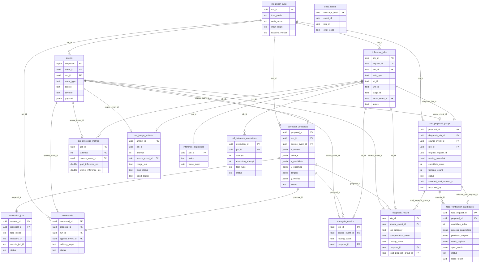

# ERD (Entity-Relationship Diagram)

- 기준일: 2026-10-23
- 출처: `database/migrations/001_create_events.sql` ~ `011_tcad_spec_verdict.sql` (전수 확인, 발췌 아님)
- 범위: Aiven PostgreSQL에 실제로 존재하는 15개 테이블. Jetson 로컬 SQLite outbox나 Unity 쪽 상태는 포함하지 않는다(그쪽은 이 DB의 "외부"이며 §4에 별도 기술).

---

## 1. ERD (mermaid)

---

## 2. 테이블별 설명 (마이그레이션 기준)

| 테이블 | 도입 | 역할 | 핵심 제약 |
|---|---|---|---|
| `integration_runs` | 002 | 한 번의 통합 실행(run)을 식별. `tcad_mode`/`unity_mode`/`input_origin`을 고정 | `tcad_mode`/`unity_mode` ∈ {mock,prod} |
| `events` | 001, 002에서 `run_id` 추가 | 모든 Jetson/Gateway 이벤트의 단일 append-only 로그. `sequence`가 리플레이 순서 보장 | `event_id` UNIQUE, `severity` enum |
| `dead_letters` | 003 | 파싱/검증 실패한 원본 메시지 격리 (ROS 브리지의 at-least-once 재시도 실패분) | `message_hash` PK — 동일 메시지 재격리 시 덮어쓰기 가능 구조 |
| `correction_proposals` | 002 | 레거시 보정 후보(정규화 비율 표현). TCAD 검증 → 승인까지의 상태 기계 | `status` NOT IN (verified,rejected,approved,applied) OR y_verified+result_origin 필수; approved/applied면 approved_by+approved_at 필수 |
| `verification_jobs` | 002 | `correction_proposals` 1건당 TCAD 검증 요청 1건(job-id keyed, 레거시 경로) | `proposal_id` UNIQUE(1:1), lease 쌍 제약 |
| `commands` | 002, 006에서 `delivery_target` 추가 | 승인된 보정의 적용 명령(ROS 또는 Unity WS로 전달) | `proposal_id` UNIQUE(1:1), `applied` 상태면 `applied_event_id`+`applied_at` 필수 |
| `inference_jobs` | 005, 008에서 `task_type`에 `diagnosis` 추가 | AOI/Surrogate/Diagnosis 공통 작업 레코드 | `(run_id,unit_id,stage_id)`에 대해 활성 상태(큐/진행중) 유일성 보장하는 부분 유니크 인덱스 |
| `inference_dispatches` | 005 | `inference_jobs`의 ROS 디스패치 리스 상태(1:1) | lease 쌍 제약 |
| `aoi_image_artifacts` | 004 | AOI 이미지의 **메타데이터만** 저장 — 실제 이미지는 Jetson 로컬에 둠(§4) | `local_path`는 생성 컬럼; `cloud_status='uploaded'`면 object_key+uploaded_at 필수; `local_status='deleted'`면 반드시 먼저 업로드 완료 |
| `inference_dispatches`/`aoi_image_artifacts`/`aoi_inference_metrics`의 `job_id`는 **`inference_jobs.job_id`를 참조하는 외래키가 코드상 선언돼 있지 않음** — 애플리케이션 레벨에서만 일치 보장 | — | — | — |
| `surrogate_results` | 006 | Surrogate(간이 원인분석) ML 응답 1건, 1:1 `inference_jobs` | `routing_status` ∈ {normal,verification_queued,review_required,failed} |
| `aoi_inference_metrics` | 007 | AOI part/defect 모델 추론 시간 메트릭(시도별) | PK (job_id, attempt) — 재시도마다 별도 행 |
| `diagnosis_results` | 008, 010에서 `tcad_proposal_group_id` 추가 | Diagnosis ML 응답 1건, 1:1 `inference_jobs`. TCAD 라우팅 여부(`compensation_route`) 포함 | `compensation_route` ∈ {tcad_verify,no_action,manual} |
| `ml_inference_executions` | 008, 009에서 `execution_attempt` 추가 | Surrogate/Diagnosis 모델 호출 1회(재시도 포함)의 실행 메트릭 | UNIQUE(job_id, attempt, execution_attempt) — 같은 stage_attempt 내 모델 재호출까지 구분 |
| `tcad_proposal_groups` | 010 | **신규** TCAD 후보 묶음(= 한 번의 diagnosis에서 나온 여러 보정 후보). Unity 승인 대상의 단위 | `diagnosis_job_id`/`source_event_id` UNIQUE(1:1); `terminal_count<=candidate_count`; `approved_by`/`approved_at`는 함께 NULL이거나 함께 값 존재 |
| `tcad_verification_candidates` | 010, 011에서 `spec_verdict` 추가 | 그룹 내 후보 1건(TCAD에 개별 제출·폴링되는 단위) | UNIQUE(proposal_id, candidate_index); lease 쌍 제약; `status` 8종 enum |

---

## 3. 두 개의 병렬 파이프라인 (설계상 핵심 특징)

ERD에서 가장 눈에 띄는 구조적 특징은 **보정 후보가 두 개의 분리된 테이블 체인으로 존재한다는 점**이다.

**경로 A (레거시, 002)**: `correction_proposals → verification_jobs(1:1) → commands(1:1)`. TCAD 검증은 `verification_jobs`(job-id keyed)가 담당하고, 승인은 `commands.status`로 추적되며 ROS 또는 Unity WS(`delivery_target`)로 전달된다.

**경로 B (신규, 010)**: `diagnosis_results → tcad_proposal_groups(1:1, diagnosis_job_id) → tcad_verification_candidates(1:N)`. TCAD 검증은 request-id keyed로 후보별 개별 제출되고, 승인은 `tcad_proposal_groups.selected_tcad_request_id`(그룹 내 후보 중 하나를 가리키는 지연 외래키)로 기록된다. 승인 시 Unity에 반환되는 `process_parameters`는 `commands` 테이블을 거치지 않는다.

두 경로는 **스키마 레벨에서 교차 참조가 없다** — `tcad_proposal_groups`가 `correction_proposals`를 참조하지 않고, `commands`도 `tcad_verification_candidates`를 참조하지 않는다. `diagnosis_results.proposal_id`(→`correction_proposals`, 008)와 `diagnosis_results.tcad_proposal_group_id`(→`tcad_proposal_groups`, 010)가 같은 테이블에 나란히 존재하지만 상호 배타적으로 쓰인다(현재 운영 데이터는 전부 경로 B만 사용). 이는 `requirements-definition.md`와 `interface-definition.md`에서도 동일하게 플래그된, 통합되지 않은 두 승인 메커니즘의 DB 레벨 근거다.

---

## 4. DB 경계 밖 저장소 (참고)

| 데이터 | 저장 위치 | DB와의 연결 |
|---|---|---|
| AOI 원본/annotated JPEG 바이너리 | Jetson 로컬 파일시스템(`local_directory`+`file_name`) | `aoi_image_artifacts`가 경로·해시·상태만 보관(§2) — Aiven DB는 바이너리를 갖지 않음 |
| Jetson outbox(이벤트 재발행용) | Jetson 로컬 SQLite | `events.received_at` 커밋 전까지 Jetson이 보유; ACK는 `/fab/event_acks`(ROS) 경로로만 전달, DB 테이블 없음 |
| TCAD 실제 Silvaco 작업 상태 | TCAD 워크스테이션(외부 프로세스) | `tcad_verification_candidates.latest_response_body`에 폴링 결과만 스냅샷, 원본 데크/로그는 DB 밖 |

---

## 5. 알려진 스키마 격차

| 격차 | 내용 | 영향 |
|---|---|---|
| `job_id` FK 미시행 (3곳) | `inference_dispatches`/`aoi_image_artifacts`/`aoi_inference_metrics`의 `job_id`가 `inference_jobs.job_id`를 참조하는 FK 제약이 코드에 없음(`inference_dispatches`는 PK 자체가 FK라 실질 보장되지만, 나머지 둘은 애플리케이션 레벨 일치에만 의존) | `inference_jobs` 행이 삭제/오기입되면 orphan 가능성 — 현재 운영에서 DELETE 경로가 없어 실제 위험은 낮음 |
| `dead_letters.event_id`/`run_id` FK 미시행 | 파싱 실패 메시지는 구조가 보장 안 되므로 의도적으로 느슨하게 설계된 것으로 보임(주석 없음, 추정) | 격리 테이블 특성상 낮은 위험 |
| 두 보정 경로 공존(§3) | 스키마 설계가 두 세대의 요구사항을 모두 반영한 채 통합 안 됨 | 신규 개발 시 어느 경로를 확장할지 혼동 가능 — 제품 결정 필요(이미 다른 문서에서도 플래그됨) |

---

## 6. 관련 문서

- `docs/architecture/current-system-architecture.md`
- `docs/architecture/interface-definition.md`
- `docs/requirements/requirements-definition.md`
