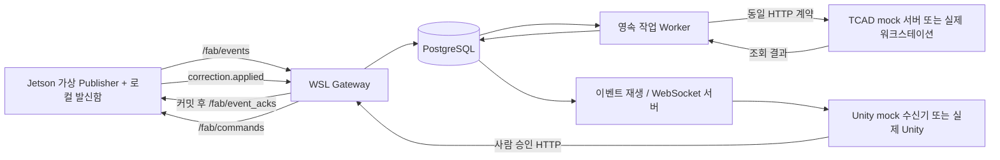

# Jetson ROS 2 · TCAD · Unity 통합 아키텍처

작성일: 2026-10-14
상태: mock/prod 분리 최종 설계 — 구현·실장비 검증 전
관련 문서: [최종 TDD 계획](../plans/jetson-tcad-unity-integration-tdd-plan.md), [DDL 명세](../database/integration-schema.md)

## 1. 현재 목표와 구현 경계

Jetson → WSL ROS 2 수신 → PostgreSQL 저장 → TCAD HTTP 검증 → Unity WebSocket 전달을 검증한다.
현재 TCAD와 Unity는 미완성이므로 기본 실행값은 각각 mock이다. 실제 ML 대신 명시적으로 표시한 가상 입력을 발행한다.

이번 구현은 Gateway, Jetson 테스트 노드, TCAD HTTP 모의 서버, Unity 역할의 Python 수신기, prod 어댑터와 계약 테스트를 포함한다.
Silvaco 실행, 실제 ML, Unity C# 프로젝트·화면 구현은 후속 작업이다.
prod 어댑터 구현 완료와 실제 TCAD·Unity 연동 검증 완료는 별도로 기록한다.

## 2. 모드 플래그와 책임

| TCAD_MODE | UNITY_MODE | 실행 대상 | 완료 판정 |
|---|---|---|---|
| mock | mock | 모의 TCAD HTTP 서버 + 모의 Unity 수신기 | 현재 기본 인수 시험 |
| prod | mock | 실제 TCAD HTTP 주소 + 모의 수신기 | TCAD 준비 후 시험 |
| mock | prod | 모의 TCAD + 실제 Unity 연결 대기 | UI 통신만 시험, 운영 승인 차단 |
| prod | prod | 실제 TCAD + 실제 Unity | 두 서비스 준비 후 인수 시험 |

- 허용값은 정확히 mock 또는 prod이며 잘못된 값은 시작 오류다.
- TCAD_MODE는 사용할 HTTP 주소를 선택한다. 두 모드 모두 같은 HTTP 클라이언트·스키마·worker를 사용한다.
- UNITY_MODE는 수신 프로그램 실행 정책이다. mock은 Python 수신기를 실행하고 prod는 실제 Unity의 접속을 기다린다.
- Gateway는 두 Unity 모드 모두 동일한 WebSocket **서버**다. Unity는 연결하는 클라이언트이며 별도 Unity 서버 URL을 가정하지 않는다.
- prod 장애가 발생해도 mock으로 자동 전환하지 않는다.
- 모드는 시작 시 확정한다. 재시작으로 바뀌더라도 기존 작업의 모드·대상 주소는 그대로 유지하며 새 작업에만 새 설정을 적용한다.
- PostgreSQL과 ROS 연동은 mock 플래그 때문에 가짜로 대체하지 않는다. 단위 테스트의 임시 저장소는 별개다.

## 3. 데이터 흐름



DB commit 이후 프로세스가 죽어도 DB에 남은 작업과 이벤트로 재개한다. 인메모리 알림 큐만으로 후속 처리를 보장하지 않는다.

## 4. Jetson 보존 경계와 설정 보호

기존 Ubuntu 22.04·JetPack 6.2.1·ROS 2 설치를 그대로 사용한다. 실제 ROS 배포판은 조회로 확인한다.
ROS_DOMAIN_ID, RMW_IMPLEMENTATION은 **현재 세션 값 상속**이며 0으로 덮어쓰지 않는다.
ROS·네트워크·방화벽·시스템 Python·서비스 설정 변경은 이번 작업 범위 밖이다.
Jetson 파일은 /home/jetson/project/smart_factory 아래에만 둔다.

- 생산자는 UUID가 붙은 이벤트를 프로젝트 내부 SQLite 발신함에 먼저 커밋한 다음 ROS로 발행한다.
- Gateway는 DB 커밋 후 /fab/event_acks에 event_id, run_id, sequence, status=committed를 보낸다.
- ACK 전까지 재발행하며 재시작 후 미확인 이벤트를 복구한다. DDS의 reliable QoS만으로 디스크 보존을 주장하지 않는다.
- SQLite는 Python 기본 sqlite3로 사용한다. 최종 영구 기록은 PostgreSQL이다.
- 잘못된 이벤트는 성공 ACK 없이 거절 사유를 반환하고 생산자가 보존·격리한다.
- 저장 장치 고장까지 무조건 무손실이라는 의미는 아니다. 디스크 부족 시 생산을 멈추고 오류를 표시한다.
- 명령 적용도 가상 레시피 상태 변경과 command_id 처리 기록을 같은 로컬 트랜잭션으로 저장한다. 동일 명령은 재적용하지 않고 ACK만 반복한다.

## 5. 공통 계약

공통 이벤트: schema_version=1, event_id(UUID), run_id(UUID), event_type, source, severity,
occurred_at(시간대 포함), correlation_id, causation_id(선택), payload.
Gateway가 sequence와 received_at을 부여한다. severity는 기존 events 계약과 동일하다.
run_id는 실행 세션과 모드의 경계를 식별한다.

X 키: oxide_thickness, body_dose, diffusion_time, epi_doping.
Y 키: vth, gm, id_on, bv.
representation=normalized_ratio로 시작하며 baseline_version을 반드시 기록한다.
물리량 환산은 추후 TCAD 어댑터가 baseline_version별 단위·기준값 계약을 확보한 후 수행한다.

- x_current: 현재 레시피 설정값. 이상 주입의 숨겨진 정답 노브와 구분한다.
- delta_x: 기준값 대비 비율의 가산 변화량. 1.00에서 -0.03이면 권장값은 0.97이다.
- x_candidate: x_current + delta_x, 절대 허용 오차 1e-9.
- epi_doping은 제어 불가이므로 delta=0이고 후보는 현재값과 같다.
- y_observed는 관측값, y_predicted는 선택적인 서로게이트 출력, y_verified는 검증 출력이다.
- 입력은 유한한 수만 허용하며 NaN/Infinity를 거부한다. X는 양수다.
- targets는 Y별 min/max와 단위를 포함한다. 실제 스펙 미확정 상태에서 예시 값을 실제 소자 기준으로 사용하지 않는다.

TCAD 성공은 계산 완료를 뜻한다. Gateway가 targets를 비교해 합격 여부를 별도로 판정한다.
이번 범위는 네 출력 전체를 검증하며 하나라도 누락되면 verified로 만들지 않는다. IV/BV 단계 분리는 후속 확장이다.

## 6. TCAD HTTP 계약과 mock

POST /api/v1/verifications: request_id, proposal_id, run_id, representation, baseline_version,
x_current, delta_x, x_candidate, y_observed, targets, model_version, deck_template_version.
응답 202: job_id와 request_id. 동일 ID·동일 내용은 같은 job_id, 다른 내용은 409.
GET /api/v1/verifications/{job_id}: queued/running/succeeded/failed.
성공 결과에는 request_id, job_id, y_verified, result_origin(mock/prod), deck_template_version이 필요하다.
Gateway는 ID와 저장된 모드가 일치하는지 확인한다. prod 작업에 mock 결과가 오면 거부한다.

mock 서버는 고정된 fixture와 seed로 재현 가능한 결과를 반환한다. 물리 모델이나 원인 진단 모델이 아니다.
시나리오: pass, out_of_spec, timeout, server_error, malformed_response.
모의 서버도 요청 ID 매핑을 로컬 SQLite에 보존해 재시작 후 같은 요청이 다른 작업으로 바뀌지 않게 한다.
HTTP 클라이언트의 timeout·5xx는 재시도, 계약 오류·409는 운영자 확인이 필요한 실패로 기록한다.

## 7. 작업 복구와 결과 출처

proposal → queued → running → verified/rejected/failed.
out_of_spec은 rejected, HTTP 계약 실패나 계산 실패는 failed로 구분한다.

작업 claim은 짧은 트랜잭션에서 lease_token·lease_until을 기록하고 커밋한다.
HTTP 대기 중 DB 잠금을 유지하지 않는다. 만료 lease는 재시도하며 오래된 worker 결과는 토큰 비교로 거부한다.
수신 결과·보정안 상태·감사 이벤트는 하나의 트랜잭션이다.

mock 결과에도 result_origin=mock을 저장한다.
가상 입력은 input_origin=synthetic으로 기록하고 prod TCAD를 사용해도 실측 검증이라고 표시하지 않는다.
UNITY_MODE=prod에서는 mock 검증 결과의 승인을 거부한다.
mock/mock에서는 사람이 demo 승인을 요청할 수 있으나 명령 scope=simulation만 허용한다.
모든 승인은 사람 입력으로만 수행한다.

## 8. Unity 전달·재생

Gateway: GET /api/v1/events?run_id=...&after_sequence=...&limit=200, WS /api/v1/stream?run_id=...&after_sequence=...
페이지 한도 1..1000. 두 경로는 같은 커밋 이벤트 저장소를 읽는다.
Unity mock은 실제 WebSocket에 접속해 받은 보정값과 출처를 확인하고 커서를 파일에 저장한다.

- sequence는 연속 번호가 아니다. rollback이나 run 필터로 생긴 빈 번호를 누락으로 간주하지 않는다.
- 단순 identity는 동시 트랜잭션의 커밋 순서를 보장하지 않는다. 모든 이벤트 쓰기는 공통 트랜잭션 advisory lock 획득 후 sequence를 할당한다.
- 이 초기 직렬화 규칙을 지키는 이벤트만 커서 기반 전달 대상으로 한다. 다중 worker 우회 삽입을 허용하지 않는다.
- 스트림은 DB를 커서 기반으로 반복 조회한다. 선택적 알림은 깨우는 신호일 뿐 DB 기록을 대체하지 않는다.
- 연결 재시작·커밋 직후 Gateway 종료에도 DB에서 다시 읽는다. 느린 수신자는 연결을 끊고 재생하도록 한다.

## 9. .env 계약

실제 값은 각 호스트의 로컬 .env에 보관하며 Git에는 .env.example만 둔다.
Jetson SSH 비밀번호나 DB URL 전체를 문서·로그·테스트 실패 출력에 노출하지 않는다.
Jetson 배포 파일에는 DB·TCAD 자격 증명을 복사하지 않는다.

```dotenv
TCAD_MODE=mock
UNITY_MODE=mock
TCAD_MOCK_URL=http://127.0.0.1:8100
TCAD_PROD_URL=
TCAD_MOCK_SCENARIO=pass
TCAD_MOCK_SEED=42
TCAD_HTTP_TIMEOUT_SECONDS=10
TCAD_POLL_INTERVAL_SECONDS=5
DATABASE_URL=
TEST_DATABASE_URL=
GATEWAY_HOST=0.0.0.0
GATEWAY_PORT=8000
UNITY_GATEWAY_WS_URL=ws://127.0.0.1:8000/api/v1/stream
ROS_EVENT_TOPIC=/fab/events
ROS_EVENT_ACK_TOPIC=/fab/event_acks
ROS_COMMAND_TOPIC=/fab/commands
# ROS_DOMAIN_ID와 RMW_IMPLEMENTATION은 기존 셸 환경 상속
JETSON_HOST=
JETSON_USER=
JETSON_PASSWORD=
JETSON_PROJECT_PATH=/home/jetson/project/smart_factory
```

prod 선택 시 TCAD_PROD_URL이 비어 있으면 시작을 거부한다. 실제 주소를 추측하지 않는다.
WSL에서 Windows PostgreSQL 접근 주소는 현재 네트워크 모드에서 조회·연결 시험으로 확인한다.
기존 postgres-db 컨테이너를 재사용하며 동일 55432 포트로 Compose를 동시에 기동하지 않는다.
테스트는 별도 TEST_DATABASE_URL과 임시 스키마에서 수행한다.

## 10. 구현·검증 범위

현재 필수: mock/mock E2E, 실제 PostgreSQL, Jetson↔WSL 이벤트와 ACK, timeout·재시작·중복·모드 전환 시험.
현재 가능한 prod 검증: 로컬 계약 서버로 prod 어댑터 선택·주소·응답 검증·실패 처리 시험.
나중 검증: 실제 TCAD deck/API 연동, 실제 Unity 클라이언트 표시·승인.
실제 서비스가 없다는 이유로 mock 성공을 prod 실연동 통과로 보고하지 않는다.

DDL은 [DB 변경 명세](../database/integration-schema.md)에 정의한다. 이번 문서 수정에서 DB를 변경하지 않는다.
기존 feat/event-contract의 구현을 이어받고 초기 DDL과 계약을 처음부터 재작성하지 않는다.
