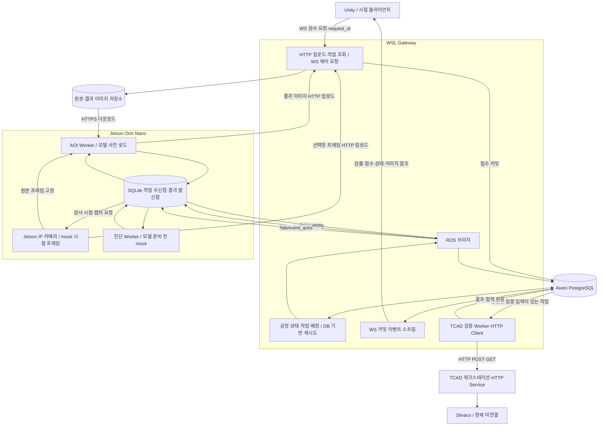

# 공정 단계별 AOI·진단·TCAD 연동 설계

> **현재 기준 안내:** 이 문서의 Unity→Gateway AOI 요청 구상은 후속 결정으로 변경됐다.
> 최신 구조와 실제 구현 상태는 [Virtual Fab 현재 시스템 아키텍처](current-system-architecture.md)를
> 따른다. AOI 실시간 요청·이미지는 Unity→Jetson WebSocket, 영구 저장은
> Jetson→Gateway ROS 2→Aiven 경로다.

기준일: 2026-10-16

후속 확정: [동시 공정 요청·관리자 승인·Unity 적용 설계](concurrent-stage-and-unity-approval.md). AOI는 정지 촬영하는 완성품 외관 검사이며 TCAD 자동 호출과 분리한다. 승인된 공정값 적용 대상은 Unity다. 여러 제품·독립 단계의 동시 실행과 중복/실행 중 요청 처리는 후속 문서를 따른다.

상태(2026-10-18): AOI 경로에 이어 전기적 ML HTTP adapter/ROS Worker·조건부 TCAD 라우팅·관리자 승인·Unity WS 적용 ACK를 구현하고 전체 mock 프로세스를 시험했다. [전체 mock 실행 및 env 전환](../runbooks/full-mock-process.md)이 현재 기준이다. 아래 모든 확장 요구(전체 장애/fencing/실카메라)의 완료를 뜻하지 않는다.

## 1. 역할과 현재 상태

| 구성요소 | 실행 위치와 책임 | 현재 확인 상태 |
|---|---|---|
| Unity | 별도 PC. 공정 진행·검사 시작 요청·결과 표시 | 외부 개발 대상. 이번 저장소에서 Unity를 개발하지 않음. Python 시험 클라이언트 사용 |
| 카메라 캡처 | Jetson. IP 카메라 영상 수신·검사 시점의 원본 프레임 고정 | 기존 OpenCV HTTP 영상 수신 스크립트 확인. 카메라 미연결·adapter 미구현 |
| Gateway | WSL. 요청 검증·영속 접수·공정 상태 전이·작업 배정·결과 중계 | ROS 이벤트 수신/Aiven 저장, HTTP 조회·승인, WebSocket 결과 스트림 있음 |
| AOI Worker | Jetson. 부품·결함 모델 사전 로드, 이미지 추론 | WSL에서 두 실제 best.pt 추론·JPG 저장·ROS 결과/ACK 확인 |
| 전기적 ML Worker | Jetson. 모델 HTTP 요청·응답 adapter | mock/prod URL 선택·ROS inbox/outbox·ML 응답 보존 구현. 실제 팀원 모델 서비스는 외부 구현 |
| TCAD HTTP Service | 별도 워크스테이션. 검증 작업 접수·Silvaco 실행·결과 조회 | mock 서버·Gateway HTTP 클라이언트·prod 미준비 서비스 틀 있음. Silvaco 연동 없음 |
| Aiven PostgreSQL | 공통 이벤트·작업·결과·공정 상태·이미지 메타데이터 | ROS 이벤트 적재/ACK 확인 이력 있음 |
| 이미지 저장소 | 개발용 지정 폴더 또는 외부 S3 호환 저장소 | 신규 기능. 실제 저장소 공급자·경로 미정 |

모델을 상주 로드하는 프로세스는 Jetson의 Worker로 정한다. Gateway는 모델 실행을 지시하고 결과를 관리한다. WSL에서 직접 추론하는 경우는 이후 별도 배치 결정으로 다룬다. 사용자 문장에 나온 “Gateway가 모델을 로드”를 이 역할 분리로 해석한 설계 제안이다.

2026-10-16 변경된 `.env`의 Jetson 주소로 SSH 읽기 전용 확인에 성공했다. 다음 두 디렉터리에 각각 `weights/best.pt`와 `weights/last.pt`가 존재한다. 카메라 연결·모델 로드·추론은 실행하지 않았으며 시스템 설정도 변경하지 않았다.

- `/home/jetson/project/smart_factory/aoi/models/mosfet_part_v5-26`
- `/home/jetson/project/smart_factory/aoi/models/mosfet_defect_v5-26`

두 `best.pt`는 `data.pkl`을 포함하는 ZIP 기반 체크포인트다. 안전한 파일 목록·해시 확인만 수행했고 pickle 역직렬화는 하지 않았다. 확인한 SHA-256은 다음과 같다.

| 모델 | best.pt SHA-256 |
|---|---|
| 부품 | `e5e9a39804ec0655ae7e62a5549d554e751c29e3fbffe4982e8511ff7b822239` |
| 결함 | `3730306060b388a797748601875e25c9d581988bd6211482e8d4537f187cd120` |

기본 Python의 설치 메타데이터는 ultralytics 8.4.118, torch 2.8.0, torchvision 0.23.0, opencv-python 5.0.0.93, onnxruntime 1.23.2, tensorrt 10.3.0이었다. 이는 패키지 import·GPU 실행·가중치 호환성 검증 결과가 아니다. `aoi/models` 바로 아래의 `best.onnx`, `best.engine`, `best.pt`도 존재하지만 어느 모델의 변환본인지 확인되지 않아 자동 선택하지 않는다.

`v5-26`이라는 이름만으로 YOLO 버전을 추정하지 않는다. 입력 크기·색상 순서, 클래스 목록, 전체 이미지/부품 ROI 학습 여부, NMS/임계값, 실제 런타임·JetPack 호환성을 확인한 뒤 prod를 활성화한다.

카메라는 **Jetson에 연결**하는 것으로 사용자 확인을 받았다. 참고 스크립트 `/home/jetson/project/test/jetson_phone_camera_rec.py`는 인증정보가 포함된 HTTP `/video` 주소를 `cv2.VideoCapture`로 열고 `cap.read()`로 프레임을 읽는다. 실제 응답의 콘텐츠 타입·코덱은 미확인이다. 기존 코드의 주소·인증정보는 복사하지 않고 향후 adapter의 `CAMERA_SOURCE_URL`로 주입한다. 로그에는 인증정보를 노출하지 않는다.

기존 스크립트는 최상위에서 카메라를 열고 터미널을 cbreak 모드로 바꾸는 대화형 프로그램이므로 Worker에서 그대로 import하지 않는다. 연결·프레임 취득·해제를 headless adapter로 분리한다. 기존 캡처는 현재 작업 디렉터리에 초 단위 파일명으로 저장하고 `cv2.imwrite` 반환값을 확인하지 않는다. 신규 adapter는 job_id/frame_id 기반 고유 경로, 저장 성공·해시 확인, 동일 작업 재시도 시 원본 고정, 타임아웃·재연결·프레임 신선도 검증을 구현해야 한다.

## 2. 아키텍처



그림은 확장 목표다. 현재 이미 있는 `/api/v1/stream`은 결과 송신용이며 검사 요청을 처리하지 않는다. 신규 제어 경로를 추가해야 한다. 영상·이미지 바이트는 ROS JSON이나 결과 WebSocket에 넣지 않는다.

## 3. 이미지 취득과 저장

저장 정책 최신 결정: [AOI 이미지 보관·DDL](../database/aoi-image-storage.md). 이번 구현은 Jetson `result/aoi` 로컬 파일의 디렉터리·파일명·절대경로·해시·상태를 Aiven에 기록하는 스키마다. 외부 이미지 저장소 선행 업로드 대신 로컬 조회와 추후 비동기 클라우드 백업으로 분리한다. 아래 HTTP 업로드/ready 절차는 후속 adapter 구현 시 이 로컬 우선 정책에 맞춰 조정하며 아직 실행 가능한 기능이 아니다.

카메라 연결 위치는 Jetson이다. `CAMERA_MODE=mock`은 Jetson의 고정 시험 이미지를 프레임으로 제공하고 `CAMERA_MODE=prod`는 IP 카메라 연결 adapter를 사용한다. 이미지 출처는 `input_origin=fixture|camera`로 기록한다. camera prod와 AOI prod는 별도 설정이다. 시험 이미지를 실제 모델에 넣는 조합도 가능하다.

Unity가 공정 검사 시점을 알려주면 Gateway가 작업을 DB에 접수하고 Jetson으로 전달한다. Jetson은 해당 job에 대응하는 한 프레임을 고정·로컬 저장하고 HTTP로 원본을 업로드한다. Gateway의 artifact 준비/DB 기록 확인 후 추론을 진행한다. 같은 job 재시도에서 다른 프레임으로 바뀌지 않게 frame_id와 원본 hash를 유지한다. 의도적인 재촬영은 새 attempt다.

캡처는 요청 시각·허용 최대 프레임 나이·해상도를 검사한다. 오래된 프레임이나 연결 실패는 capture.failed로 처리한다. 실시간 미리보기는 별도 영상 경로이며 이 JSON WebSocket 구현 범위에 넣지 않는다. Unity가 영상을 재캡처하거나 사람이 이미지를 수동 전달하는 단계는 필요하지 않다.

모든 스트림 프레임의 보존은 이번 기본 요구로 잡지 않는다. 검사를 요청한 원본 프레임과 그 결과 이미지를 보존한다. 원본과 주석 이미지의 `artifact_id`를 분리하고 원본을 덮어쓰지 않는다. 원본 SHA-256, 해상도, MIME, 크기, capture 시각·frame_id·camera_id, 대상 lot/unit/stage, 이미지 출처를 DB에 기록한다. ROI 추론이면 원본 기준 bbox 좌표 변환도 남긴다.

Aiven에는 검출 항목·confidence score·판정·artifact 메타데이터를 저장하고, 이미지 바이트는 지정 파일 저장소에 둔다. PC 용량 부족 이력이 있으므로 외부 저장소를 운영 기본안으로 두되 공급자 선택 전 실제 연결은 만들지 않는다. 로컬 저장소는 용량 제한이 있는 시험용이다. Unity와 Jetson은 저장소 자격증명을 받지 않고 Gateway의 인증된 artifact API 또는 만료 URL로 접근한다. ROS 메시지에는 만료 URL 대신 안정적인 `artifact_id`를 담는다.

업로드는 파일 저장 확인과 해시 검증 후 `artifacts.status=ready`를 DB에 기록한다. 기존 이미지를 입력으로 받는 작업은 ready 이전에 배정하지 않는다. 카메라 캡처형 작업은 캡처를 먼저 배정하고 ready 이후에 추론을 진행한다. 객체 저장과 PostgreSQL은 단일 트랜잭션이 아니므로 업로드 상태를 `pending/ready/failed`로 관리하고 재시도로 복구한다. 참조된 원본은 임의 삭제하지 않으며 미참조 업로드 정리는 별도 정책으로 처리한다. 저장 실패·용량 부족은 검사 오류로 기록하고 정상 판정으로 넘기지 않는다.

## 4. 요청·결과 계약

공통 식별자: `request_id`, `job_id`, `event_id`, `run_id`, `lot_id`, `unit_id`, `stage_id`, `stage_attempt`, `correlation_id`, `causation_id`. 모델·threshold·공정 recipe 버전과 단계 입력은 작업 생성 시 고정한다. 동일 요청 재전송은 같은 작업을 반환하며 동일 ID의 다른 본문은 충돌로 거부한다. 의도적 재검사는 새 request_id와 stage_attempt를 쓴다.

### Unity ↔ Gateway

기존 `/api/v1/stream`은 `run_id`와 `after_sequence`로 커밋 이벤트를 재생한다. 신규 `/api/v1/control` WebSocket은 작은 JSON 검사 요청을 받는다. 이미지 업로드는 별도 HTTP `POST /api/v1/artifacts`, 작업 조회는 `GET /api/v1/jobs/{job_id}`로 한다. 이는 예정 계약이며 아직 실행할 수 없다.

예정 제어 요청 예시:

```json
{
  "schema_version": 1,
  "request_id": "UUID",
  "run_id": "UUID",
  "type": "inspection.requested",
  "lot_id": "LOT-001",
  "unit_id": "MOSFET-001",
  "stage_id": "aoi_inspection",
  "stage_attempt": 1,
  "expected_stage_version": 3,
  "input": {"kind": "camera_capture", "camera_id": "aoi-camera-1"}
}
```

Gateway는 공정 단계·카메라 등록·권한(기존 이미지형이면 artifact ready)을 검증하고 요청, job, 접수 이벤트, ROS 전달 작업을 한 트랜잭션에 저장한 뒤 `request.accepted`와 job_id를 응답한다. `accepted`는 검사 완료가 아니다. 연결이 끊기면 동일 request_id로 재전송하거나 job을 조회한다. 재전송 수단이 없는 Unity 세션 종료까지 보장하려면 Unity 쪽에도 미확인 요청을 로컬에 저장해야 한다. 향후 Python mock 제어 클라이언트가 이 동작을 검증한다.

### Gateway ↔ Jetson

신규 `/fab/inference_requests`: job_id, request_id, task_type(aoi/diagnosis), input artifact/feature 참조, model version, attempt, deadline, 서명. 기존 레시피 변경 `/fab/commands`와 분리한다.

Jetson은 서명을 확인하고 SQLite inbox에 커밋한 뒤 `inference.accepted`를 결과 outbox에 기록한다. 결과와 진행 상태는 기존 `/fab/events`로 발행하며 Gateway의 `/fab/event_acks` 커밋 응답을 받을 때까지 재시도한다. Gateway는 inbox 접수 이벤트가 DB에 커밋될 때 전달 재시도를 멈춘다. 접수 후에는 실행 deadline으로 완료를 추적한다.

AOI 결과: 모델별 이름·버전·해시, 전처리 버전, 입력 artifact_id, 검출 배열(class_id, class_name, bbox, confidence), 임계값, 판정(pass/fail/review/error), 추론 시간, 결과 artifact_id, result_origin. confidence는 보정된 실제 불량 확률이라고 단정하지 않는다. 불량이 없다는 것과 부품 자체를 못 찾았다는 것을 분리한다. 부품 미검출·입력 품질 부족·낮은 점수는 pass가 아닌 review 또는 error로 처리한다.

두 모델의 실행 구성은 확인이 필요하다. `part → ROI → defect` 방식은 결함 모델이 ROI로 학습됐을 때 사용한다. 전체 이미지로 학습됐다면 두 모델에 전체 이미지를 전달한다. 경로명만 보고 모델 연결 순서를 결정하지 않는다.

### 추론 모델 상주 및 재시작

Worker 시작 시 모델 검증·로드·warmup 이후 readiness를 알린다. 준비 전 작업은 DB queue에 남는다. Jetson GPU 작업은 기본 동시 실행 1개로 시작하고 AOI/진단 우선순위와 대기시간을 계측한다. 모델 버전은 실행 중 덮어쓰지 않는다. mock 모드는 모델 의존성 없이 결정적인 fixture를 반환한다. prod 로드 실패 시 mock으로 전환하지 않는다.

## 5. ACK와 장애 복구

| 신호 | 발생 시점 | 보장하는 것 |
|---|---|---|
| Unity `request.accepted` | Gateway DB 접수 커밋 후 | 작업이 영속 접수됨 |
| Jetson `inference.accepted` | SQLite inbox 커밋 후 | 작업을 장치가 보존함 |
| `/fab/event_acks` committed | Gateway Aiven 이벤트 커밋 후 | 해당 event_id가 중앙 DB에 기록됨 |
| `inspection.completed` / `diagnosis.completed` | 추론 결과·필수 artifact 준비 후 | 결과가 생성됨. Unity에는 DB 커밋 후 전달 |
| Unity 로컬 sequence 저장 | 화면 상태/결과 처리 후 | 재접속 시작 위치. 서버 커밋 ACK를 대체하지 않음 |

ROS reliable QoS는 전송 품질이며 DB 커밋·프로세스 재시작 복구를 뜻하지 않는다. 현재 토픽+영속 inbox/outbox를 유지하고 ACK를 응용 계층에서 정의한다. 장시간 작업의 취소·feedback이 중요해지면 ROS Action을 고려하되 Action만으로 DB 영속화가 해결되지는 않는다.

at-least-once 전송과 job/event ID 중복 제거를 사용한다. 동일 job의 동시 추론은 막지만 계산 후 결과 저장 직전 장치가 죽으면 재계산할 수 있다. 정확히 한 번의 물리적 계산을 약속하지 않는다. attempt/lease 토큰으로 늦게 도착한 구버전 결과가 최신 job 상태를 덮어쓰지 못하게 한다. 실패·timeout·재시도·거절은 감사 이벤트로 남기되 heartbeat나 모든 영상 패킷을 DB 이벤트로 보존하지는 않는다.

## 6. 진단과 TCAD 연결 조건

역할 분리 확정: [Jetson ML 요청·응답 계약](ml-integration-contract.md). 서로게이트 모델의 전처리·GP 연결·Id 측정 조건·출력 정의는 ML 팀원이 담당한다. Gateway는 모델 계산을 구현하지 않고 요청/응답 전체와 버전·메타데이터를 보존한다. 아래 진단/후보 생성은 서로게이트 예측과 별도 역할이며, 실제 TCAD HTTP 요청 전 ML 결과 보존과 합의된 입력 매핑을 거친다.

AOI 외관 결함과 TCAD의 전기적 특성은 다른 문제다. AOI 불량을 바로 `body_dose`나 `oxide_thickness` 보정으로 연결하지 않는다. 진단 모델에 필요한 입력 특성·훈련 범위·출력 정의를 먼저 고정한다.

진단은 공정 단계에서 요청된 관측값과 메타데이터를 받아 원인 후보·score·신뢰 범위와 보정 가능 여부를 반환한다. TCAD 작업은 다음 조건을 모두 만족할 때 만든다.

1. 진단/규칙이 전기적 공정 검증 대상으로 분류한다.
2. 기준 recipe·단위/정규화 버전과 `x_current`, `y_observed`, targets가 준비된다.
3. 보정안 생성기가 `delta_x`, `x_candidate`를 만든다. 원인 모델과 보정안 생성기는 같은 기능이라고 가정하지 않는다.
4. 제어 불가인 epi_doping 변경을 차단하고 입력 계약 검증을 통과한다.

입력이 부족하거나 외관 결함만 있으면 `review_required`로 보류한다. 임의 X값으로 TCAD를 호출하지 않는다. 통과하면 DB에 proposal/job을 커밋한 뒤 HTTP worker가 검증 요청·조회한다. 결과와 스펙 판정도 한 트랜잭션으로 저장한다. 검증 통과 후 실제 적용 단계는 기존 사람 승인 규칙을 유지한다.

## 7. 공정 상태와 DB 확장

공정 단계 목록은 제품별 recipe로 정의한다. 현재 자료만으로 산화·확산·조립 등의 실제 라인 순서를 확정하지 않는다. UI 애니메이션 완료가 서버의 검사 통과를 의미하지 않는다. 단계 상태는 `ready → requested → queued → running → passed|failed|review_required|error`로 관리하고 허용된 다음 단계만 연다. 낡은 expected_stage_version의 요청은 거절한다.

예정 마이그레이션은 기존 001~003을 수정하지 않고 신규 파일로 추가한다. 아직 DDL을 적용하지 않는다.

| 신규 데이터 | 최소 내용 |
|---|---|
| process_stage_runs | run/lot/unit/stage/attempt, 상태, 버전, recipe 버전 |
| inference_jobs | request_id UNIQUE, job_id, task_type, 입력 해시, 모델/모드 스냅샷, deadline, lease/attempt, 상태 |
| inference_results | job별 최종 결과, 요약 판정, 모델·threshold·출처·처리시간 |
| detections | result FK, class/bbox/score/모델 단계/ROI 변환 |
| artifacts | key/sha256/size/MIME/dimensions, origin, pending/ready/failed, 보관 상태 |
| inference_dispatches | job FK, 전달 상태·시도·다음 재시도 시각 |

기존 events는 모든 주요 전이와 원본 요청·결과의 구조화 기록을 연결한다. job 상태와 감사 이벤트를 같은 DB 트랜잭션에서 갱신한다. 결과 이미지는 artifact로 연결하며 Aiven 백업과 이미지 저장소 백업·보관기간은 별도로 관리한다.

## 8. 환경변수와 모드

기존 `TCAD_MODE`, `UNITY_MODE`를 유지하고 `CAMERA_MODE`, `AOI_MODE`, `DIAGNOSIS_MODE`를 추가하는 설계다. 각각 mock/prod이며 통신은 양쪽 모두 실제 HTTP/WebSocket/ROS를 사용한다. 기능별 플래그이므로 네트워크용 제3의 모드는 필요 없다. prod는 실행 엔진의 종류이고 입력이 실측이라는 뜻이 아니다. input_origin과 result_origin을 따로 저장한다.

환경변수 초안은 [호스트별 예시](../examples/process-inspection.env.example)에 있다. 카메라·AOI·이미지 저장소 키는 설계 자료이며 현재 앱이 아직 읽지 않는다. `TCAD_BIND_HOST/PORT`와 `UNITY_GATEWAY_HTTP_URL`은 이번 통신 틀에서 읽는다. 기존 실제 `.env`는 수정하지 않았다. 기존 run은 모드가 고정되므로 모드를 바꿀 때 새 run_id로 시험한다. Worker와 Gateway 모드·모델 버전이 다르면 작업을 실행하지 않고 오류를 보고하도록 구현한다.

## 9. 구현 순서와 검증

1. 계약/DDL/공정 상태와 이미지 업로드·다운로드·저장 원자성 경계.
2. WS 제어 요청·HTTP job 조회·Python 시험 클라이언트의 영속 request_id.
3. ROS inference request, Jetson inbox/outbox·ACK·재시작 복구, mock Worker.
4. 실제 AOI 모델 형식·전처리 확인 후 prod adapter·warmup.
5. 진단 mock과 TCAD 진입 조건. 실제 진단 모델 준비 후 prod adapter.
6. 별도 호스트 mock 통신, 실모델 검증, 실제 TCAD·Unity 연결 단계별 시험.

각 단계는 계약 실패·중복·단절 시험을 먼저 작성하고 구현한다. 세부 합격 기준은 [테스트 프로세스](../runbooks/process-inspection-test.md)에 있다. mock 통신 통과, prod AOI 추론 통과, 실제 TCAD 계산 통과를 별도 결과로 기록한다.

## 근거

- [ROS 2 QoS 설계](https://design.ros2.org/articles/qos): reliability와 durability 정책의 범위.
- [ROS 공식 인터페이스 문서 소스](https://github.com/ros2/ros2_documentation/blob/rolling/source/ROS-Framework/Interfaces-Topics-Services-Actions.rst): 장시간 동작과 feedback에 대한 Action의 역할. 이 설계는 현재 Humble 토픽 계약을 우선 유지한다.
