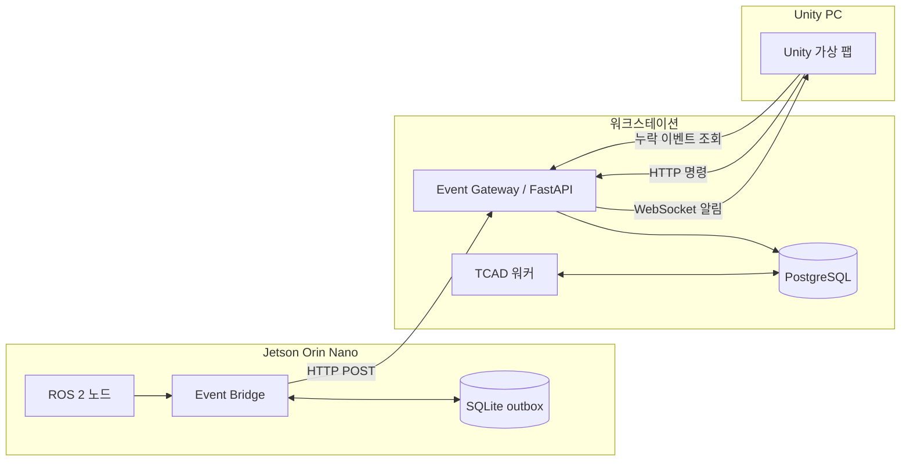

# 가상 팹 ROS 2 이벤트 파이프라인 설계

> **현재 기준 안내:** 최신 전체 구조는
> [Virtual Fab 현재 시스템 아키텍처](current-system-architecture.md)를 따른다.
> 특히 AOI 요청·결과 이미지는 Gateway가 아니라 Jetson WebSocket으로 직접 통신한다.

> 이전 HTTP 브리지 설계 기록이다. 현재 구현 기준은 [mock/prod 통합 아키텍처](jetson-ros2-tcad-unity-integration.md)이며, 충돌 시 새 문서를 따른다.

작성일: 2026-10-14  
상태: 검토 요청  
범위: Jetson Orin Nano의 ROS 2 이벤트를 PostgreSQL에 보존하고 Unity에 실시간 전달

## 1. 목적

이 문서는 실측 장비 없이 TCAD 합성 데이터로 동작하는 가상 팹에서 이벤트를 안전하게 기록하고 Unity 대시보드에 전달하는 구조를 정의한다.

첫 구현의 성공 조건은 다음과 같다.

1. Jetson의 ROS 2 이벤트가 네트워크 장애와 프로세스 재시작에도 유실되지 않는다.
2. 워크스테이션의 PostgreSQL이 영구 이벤트 기록의 단일 진실 원천이 된다.
3. Unity는 PostgreSQL에 직접 접속하지 않고 HTTP와 WebSocket으로 명령과 상태를 교환한다.
4. 중복 전송이 발생해도 PostgreSQL에는 이벤트가 한 번만 기록된다.
5. Unity가 연결 중 실시간 알림을 놓쳐도 재연결 후 누락 이벤트를 복구한다.

## 2. 범위와 비범위

### 포함

- Jetson 내부 ROS 2 이벤트 구독
- Jetson 로컬 발신함(outbox)
- HTTP 기반 이벤트 수집 API
- PostgreSQL 이벤트 영속화
- WebSocket 기반 Unity 실시간 알림
- 재시도, 중복 제거, 재연결 후 누락 복구
- 단위·통합·장애 복구 테스트

### 제외

- 실제 팹 장비와의 연결
- MQTT와 별도 메시지 브로커
- TCAD 실행 및 서로게이트 추론 구현
- Unity 대시보드의 최종 그래픽
- 클라우드 서비스와 외부 네트워크 호출

## 3. 설계 결정

### 3.1 PostgreSQL을 단일 진실 원천으로 사용한다

보존 대상 이벤트는 워크스테이션의 PostgreSQL에 저장된 뒤에만 수신 완료로 간주한다. WebSocket과 PostgreSQL `LISTEN/NOTIFY`는 실시간 알림 수단일 뿐 영구 보존 수단이 아니다.

### 3.2 SQLite는 Jetson의 임시 발신함으로만 사용한다

SQLite는 업무 데이터의 최종 저장소가 아니다. Jetson에서 생성됐지만 PostgreSQL 저장 확인을 받지 못한 이벤트만 임시 보관한다. HTTP 성공 응답을 받은 이벤트는 발신함에서 제거한다.

이 선택은 다음 문제를 해결한다.

- LAN 또는 워크스테이션 장애 중 이벤트 유실 방지
- Jetson 프로세스·전원 재시작 후 미전송 이벤트 복구
- 파일 덮어쓰기와 부분 쓰기 없이 원자적으로 큐 상태 관리
- 추가 서버나 메시지 브로커 없이 재시도 구현

이벤트 발생량과 보존 요구가 낮은 초기 데모에서는 SQLite를 비활성화할 수 있게 구성하되, 필수 보존 시험에서는 활성화한다.

### 3.3 명령은 HTTP, 실시간 상태는 WebSocket을 사용한다

- Jetson → Event Gateway: `POST /api/v1/events`
- Unity → Event Gateway: 이상 주입과 승인용 HTTP API
- Event Gateway → Unity: 저장 완료 이벤트의 WebSocket 알림
- Unity → Event Gateway: 재연결 후 누락 이벤트 HTTP 조회

HTTP는 저장 성공 여부를 명확히 응답하고 재시도하기 쉽다. WebSocket은 Unity의 실시간 표현에만 사용한다.

### 3.4 MQTT는 초기 범위에서 제외한다

모든 이벤트 생산자와 소비자가 동일한 사내 LAN의 소프트웨어 구성 요소이고, PostgreSQL이 이미 작업 큐와 감사 기록을 담당한다. 별도 브로커를 추가하면 운영 지점과 장애 모드만 늘어난다. 생산자·소비자 수 또는 이벤트 처리량이 크게 증가할 때 다시 평가한다.

## 4. 전체 구조



ROS 2는 Jetson 내부 프로세스 간 이벤트 전달에만 사용한다. 컴퓨터 간 통신과 영속화 경계는 Event Gateway가 담당한다.

## 5. 구성요소 책임

### 5.1 ROS 2 이벤트 생산자

- 감시, 진단, 보정, 보고 단계의 구조화 이벤트를 발행한다.
- 네트워크와 PostgreSQL의 존재를 알지 않는다.
- 최초 개발 토픽은 `/fab/events`, 타입은 `std_msgs/msg/String`의 JSON으로 시작한다.
- 스키마가 안정되면 전용 ROS 2 메시지 타입으로 교체할 수 있다.

### 5.2 Jetson Event Bridge

- ROS 2 토픽을 구독한다.
- JSON 스키마를 검증한다.
- 이벤트에 `event_id`와 발생 시각을 부여한다.
- 전송 전에 SQLite outbox에 이벤트를 기록한다.
- Event Gateway에 HTTP로 전송한다.
- PostgreSQL 커밋을 의미하는 성공 응답을 받은 뒤 outbox 항목을 완료 처리한다.
- 지수 백오프와 jitter를 적용해 재시도한다.

### 5.3 Event Gateway

- Jetson과 Unity의 유일한 애플리케이션 진입점이다.
- 요청 스키마와 상태 전이 규칙을 검증한다.
- PostgreSQL 트랜잭션으로 이벤트와 관련 상태를 저장한다.
- 동일 `event_id`의 재요청을 성공으로 응답하되 중복 행을 만들지 않는다.
- 커밋 완료 후 연결된 Unity 클라이언트에 WebSocket 알림을 보낸다.
- 순번 기반 누락 이벤트 조회 API를 제공한다.

### 5.4 PostgreSQL

- 이벤트, 로트, 진단, 보정안, 검증 작업의 영구 저장소다.
- 이벤트마다 서버가 단조 증가시키는 `sequence`를 부여한다.
- `event_id`의 고유 제약으로 멱등성을 보장한다.
- PostgreSQL 작업 큐는 TCAD 워커에 계속 사용할 수 있다.

### 5.5 Unity

- HTTP API를 통해 이상 주입과 사람 승인을 요청한다.
- WebSocket을 통해 커밋 완료 이벤트를 실시간으로 받는다.
- 마지막 처리 `sequence`를 로컬에 기록한다.
- 재연결 시 마지막 순번 이후 이벤트를 HTTP로 조회한 뒤 실시간 스트림을 재개한다.
- DB 접속 정보나 직접 쓰기 권한을 갖지 않는다.

## 6. 이벤트 계약

초기 공통 이벤트 형식은 다음과 같다.

```json
{
  "schema_version": 1,
  "event_id": "0199f0a4-5a8c-7b8e-9c10-0123456789ab",
  "event_type": "diagnosis.completed",
  "source": "jetson.orchestrator",
  "occurred_at": "2026-10-14T10:30:00.123+09:00",
  "severity": "info",
  "correlation_id": "lot-2026-0012",
  "causation_id": "0199f09f-1111-7222-8333-444444444444",
  "payload": {
    "lot_id": 12,
    "ambiguous": false
  }
}
```

규칙:

- `event_id`: 생산자가 한 번 생성하고 재시도에서도 유지한다.
- `occurred_at`: 생산자에서 사건이 발생한 시각이다.
- `received_at`: 서버가 별도로 기록한다.
- `correlation_id`: 동일 로트나 진단 흐름을 묶는다.
- `causation_id`: 현재 이벤트를 일으킨 직전 이벤트를 가리킨다.
- `payload`: 이벤트 유형별 데이터이며 스키마 버전으로 진화시킨다.
- 내부 기준 시각은 UTC로 저장하고 UI에서 Asia/Seoul로 표시한다.

## 7. PostgreSQL 초안

기존 `events` 개념을 다음과 같이 강화한다. 실제 DDL은 별도 마이그레이션 파일에서 관리한다.

```sql
CREATE TABLE events (
    sequence       BIGINT GENERATED ALWAYS AS IDENTITY PRIMARY KEY,
    event_id       UUID NOT NULL UNIQUE,
    schema_version INTEGER NOT NULL,
    event_type     TEXT NOT NULL,
    source         TEXT NOT NULL,
    severity       TEXT NOT NULL,
    correlation_id TEXT,
    causation_id   UUID,
    payload        JSONB NOT NULL,
    occurred_at    TIMESTAMPTZ NOT NULL,
    received_at    TIMESTAMPTZ NOT NULL DEFAULT clock_timestamp(),
    CHECK (schema_version > 0),
    CHECK (severity IN ('debug', 'info', 'warning', 'error', 'critical'))
);

CREATE INDEX events_type_sequence_idx
    ON events (event_type, sequence);

CREATE INDEX events_correlation_sequence_idx
    ON events (correlation_id, sequence)
    WHERE correlation_id IS NOT NULL;

CREATE INDEX events_occurred_at_idx
    ON events (occurred_at);
```

API가 이벤트 삽입과 도메인 상태 변경을 함께 수행할 때는 반드시 하나의 PostgreSQL 트랜잭션으로 커밋한다. 이벤트만 저장되고 상태가 반영되지 않거나 그 반대인 상황을 허용하지 않는다.

## 8. 정상 데이터 흐름

1. Jetson ROS 2 노드가 `/fab/events`에 이벤트를 발행한다.
2. Event Bridge가 스키마를 검증하고 SQLite outbox에 저장한다.
3. Event Bridge가 같은 `event_id`로 Event Gateway에 HTTP 요청한다.
4. Gateway가 PostgreSQL 트랜잭션을 커밋한다.
5. Gateway가 `sequence`를 포함한 HTTP 성공 응답을 반환한다.
6. Event Bridge가 outbox 항목을 완료 처리한다.
7. Gateway가 Unity에 WebSocket 알림을 보낸다.
8. Unity가 `sequence` 순서대로 화면 상태를 갱신한다.

Unity에서 시작하는 이상 주입도 Gateway가 PostgreSQL에 명령과 감사 이벤트를 먼저 저장한 다음 Jetson 오케스트레이터가 가져가 처리한다. 초기 구현은 Jetson의 주기적 HTTP 조회로 시작하고, 지연 요구가 확인되면 서버의 명령 WebSocket이나 PostgreSQL 기반 작업 큐 소비 방식으로 확장한다.

## 9. 장애 처리

### Jetson과 Gateway 사이 네트워크 단절

- 이벤트는 SQLite outbox에 남는다.
- Bridge가 백오프로 재전송한다.
- 동일 `event_id` 재전송은 PostgreSQL 고유 제약으로 중복 제거한다.

### PostgreSQL 장애

- Gateway는 성공 응답과 WebSocket 알림을 보내지 않는다.
- Bridge는 이벤트를 outbox에 유지한다.
- Unity 명령은 실패로 표시하고 사용자가 재시도할 수 있게 한다.

### 커밋 후 HTTP 응답 유실

- Bridge가 동일 `event_id`로 재전송한다.
- Gateway는 기존 행의 `sequence`를 반환한다.
- PostgreSQL에는 한 행만 존재한다.

### Unity WebSocket 단절

- 이벤트 보존에는 영향이 없다.
- Unity는 재연결 후 마지막 처리 순번 이후의 이벤트를 조회한다.
- 조회를 완료한 뒤 버퍼링된 WebSocket 이벤트를 순서대로 적용한다.

### Jetson 재시작

- Bridge는 시작할 때 outbox의 미완료 이벤트를 조회한다.
- 오래된 순서부터 재전송한다.

## 10. API 초안

| 메서드 | 경로 | 목적 |
|---|---|---|
| `POST` | `/api/v1/events` | Jetson 이벤트 저장 |
| `GET` | `/api/v1/events?after_sequence={n}` | Unity 누락 이벤트 조회 |
| `WS` | `/api/v1/stream` | Unity 실시간 이벤트 수신 |
| `POST` | `/api/v1/lots/injections` | Unity 이상 로트 주입 |
| `POST` | `/api/v1/proposals/{id}/approval` | 검증 완료 보정안 승인 |
| `GET` | `/health/live` | Gateway 프로세스 상태 |
| `GET` | `/health/ready` | PostgreSQL 포함 준비 상태 |

HTTP 성공 응답은 해당 이벤트가 PostgreSQL에 커밋됐음을 의미한다. 단순히 Gateway 메모리에 접수됐다는 의미로 사용하지 않는다.

## 11. 보안과 운영 범위

초기 데모는 격리된 동일 LAN에서 실행한다.

- DB 포트는 Jetson과 Unity에 공개하지 않는다.
- Gateway만 PostgreSQL 자격 증명을 가진다.
- Gateway 주소와 포트는 환경 변수로 설정한다.
- payload에 모델 파일, 공정 기밀 원문 또는 자격 증명을 넣지 않는다.
- 개발 로그에 전체 DB URL이나 비밀번호를 출력하지 않는다.
- 운영 전환 시 TLS와 클라이언트 인증을 별도 설계한다.

## 12. TDD 검증 전략

### 단위 테스트

- 이벤트 스키마의 정상·오류 입력 검증
- SQLite outbox 저장, 완료 처리, 재시작 복구
- 재시도 백오프 계산
- Gateway의 멱등 삽입
- Unity 순번 정렬 및 중복 무시 로직

### 통합 테스트

- HTTP 요청 한 번이 PostgreSQL 이벤트 한 행을 생성하는지 확인
- 같은 `event_id`를 여러 번 보내도 한 행만 존재하는지 확인
- DB 커밋 이후에만 WebSocket 알림이 전송되는지 확인
- Unity 누락 조회가 `sequence` 경계를 정확히 처리하는지 확인
- 이상 주입 명령과 감사 이벤트가 한 트랜잭션으로 저장되는지 확인

### 장애 복구 테스트

- Gateway 중단 중 생성한 이벤트가 Jetson에 보존되는지 확인
- 커밋 직후 응답 연결을 끊고 재전송해도 중복이 없는지 확인
- Jetson Bridge를 강제 종료한 뒤 미전송 이벤트가 복구되는지 확인
- Unity를 중단한 동안 생성된 이벤트가 재연결 후 모두 재생되는지 확인
- PostgreSQL 재시작 동안 Gateway가 성공 응답을 잘못 반환하지 않는지 확인

### 완료 기준

1. 정상 경로에서 ROS 2 이벤트가 PostgreSQL과 Unity에 동일한 내용으로 도달한다.
2. 네트워크 단절 중 생성한 테스트 이벤트가 복구 후 모두 PostgreSQL에 저장된다.
3. 모든 재시도 시험에서 `event_id`별 PostgreSQL 행이 정확히 하나다.
4. Unity가 오프라인 동안 놓친 이벤트를 순번대로 복구한다.
5. 테스트가 실제 TCAD나 외부 네트워크 없이 반복 실행된다.

## 13. 구현 단계 경계

1. 공통 이벤트 계약과 PostgreSQL DDL
2. Event Gateway의 영속 수집 API
3. Jetson SQLite outbox와 HTTP 전송기
4. ROS 2 구독 어댑터
5. Gateway WebSocket 스트림과 누락 조회 API
6. Unity HTTP·WebSocket 클라이언트
7. 이상 주입과 승인 명령
8. 네트워크·프로세스 장애 복구 시험

각 단계의 구체적인 실패 테스트와 구현 순서는 별도 TDD 구현 계획에서 정의한다.

## 14. 후속 결정

- ROS 2 JSON 토픽을 전용 메시지 타입으로 전환할 시점
- 이벤트 보존 기간과 PostgreSQL 파티셔닝 기준
- Jetson 명령 수신을 폴링에서 장기 연결로 바꿀 필요가 있는지 여부
- TLS와 장치 인증을 적용할 배포 단계
- 이벤트량과 소비자 수가 증가할 때 메시지 브로커 도입 기준
