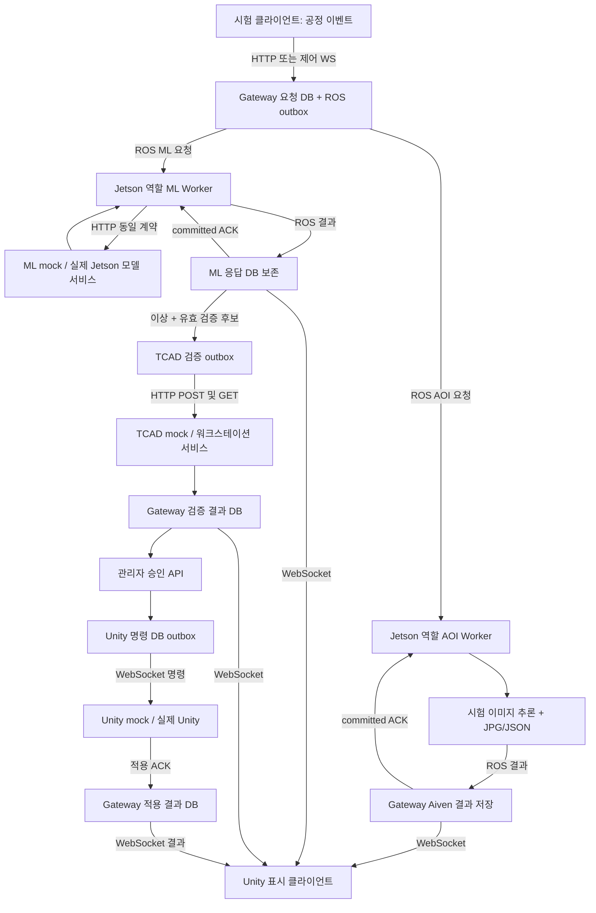

# 전체 mock 공정 실행과 실제 서비스 전환

기준: 2026-10-18. 이 문서가 전체 mock 실행의 현재 기준이다. 이전 개별 AOI/TCAD 가이드와 구분한다.

Jetson AOI 결과를 Unity에 직접 보내는 추가 저지연 시험은 [AOI→Unity 직접 WebSocket 시험](aoi-unity-direct-test.md)을 따른다. 이 추가 경로는 아래 전체 E2E를 변경하거나 대체하지 않는다.

## 1. 지금 한 번에 실행하기

WSL Ubuntu-22.04 터미널에서:

```bash
cd /mnt/c/posco_project
bash scripts/run-mock-e2e.sh
```

`.env`의 Aiven 연결을 사용하고, 이 PC에서 확인한 `ROS_TEST_PROFILE=/home/user/fastdds.xml`을 읽는다. 프로필을 명시하려면 다음과 같이 실행한다.

```bash
bash scripts/run-mock-e2e.sh --ros-profile /home/user/fastdds.xml --timeout 180
```

필요한 환경은 ROS 2 Humble과 `$HOME/posco-gateway-venv/bin/python`이다. 다른 venv는 `GATEWAY_PYTHON`으로 지정한다. 이전과 동일하게 `jetson_ws/images/test_aoi_mosfet1.jpg`가 있어야 한다. mock AOI는 실제 이미지 읽기/JPG 저장을 수행하고 탐지 결과만 고정값을 사용한다. 실제 best.pt 시험은 [AOI 실모델 가이드](wsl-aoi-one-pc.md)를 따른다.

runner가 시작하는 프로세스:

- Gateway HTTP/WS, Gateway ROS bridge, TCAD 검증 Worker
- Jetson 역할 AOI Worker, Jetson 역할 전기적 ML ROS Worker
- ML mock HTTP 서비스, TCAD mock HTTP 서비스, Unity mock WS 적용 peer

HTTP 포트와 ROS 토픽을 실행마다 분리한다. 현재 실행 중인 사용자 서비스는 종료하지 않는다. Aiven에는 `test_e2e_<UUID>` 스키마를 생성하고 그 안에서 migration을 적용한다. public 업무 기록은 이 시험에서 수정하지 않는다. 종료 시 runner가 시작한 프로세스만 정리하고, DB 시험 스키마와 `data/mock-e2e/<run_id>/` 로그/이미지/SQLite/report.json은 보존한다.

마지막 `status=passed`가 전체 시험의 성공 기준이다. 중간의 `queued` 출력은 접수 결과이며 최종 성공을 뜻하지 않는다. 실패하면 report의 `error_type`과 각 서비스 `.log`를 확인한다. 비밀 URL/토큰은 보고서에 넣지 않는다.

시작 전 독립 ROS publisher/subscriber로 짧은 왕복 진단을 수행한다. Fast DDS discovery가 8초보다 늦으면 `ROS preflight warning`을 남기지만 실제 장기 실행 서비스 시험은 계속한다. 최종 성공 기준은 이 진단이 아니라 아래 전체 서비스의 `status=passed`다. 같은 도메인/프로필에서 진단만 재현하는 명령은 `python scripts/ros_discovery_probe.py --simple --domain 0 --profile /home/user/fastdds.xml`이다.

## 2. 실제로 시험하는 흐름



AOI 외관 불량만으로 TCAD를 요청하지 않는다. 전기적 ML 결과에 이상이 있고 유효한 `tcad_proposal`이 있는 경우에만 검증 작업을 만든다.

한 시험 run에서 병행 접수하는 작업은 AOI 1건과 ML 4건이다.

| 사례 | 기대 결과 |
|---|---|
| AOI mock 결함 | JPG 2개, 탐지/경로 DB, ROS ACK, WS 표시 |
| ML normal | 응답 원형/측정 조건 DB, WS 표시, TCAD 0건 |
| ML anomaly | 응답 DB, TCAD HTTP 검증 1건, 검증 결과 DB/WS |
| ML missing_candidate | 응답 DB, routing_status=review_required, TCAD 0건 |
| ML failed | 응답 DB, job=failed, TCAD 0건 |
| 검증 통과 후 테스트 승인 | Unity 명령 → 적용 ACK → DB applied |
| 동일 요청 재전송/중복 적용 ACK | 기존 job/명령 유지, Unity 로컬 적용 기록 1건 |

runner 안의 승인은 강제로 mock 모드인 합성 시험 run에 한정한 테스트 입력이다. 아래 장기 실행 스크립트는 자동 승인하지 않는다. 실제 운영에는 관리자 API 요청이 필요하다.

## 3. 현재 .env로 장기 실행하기

기존 수동 실행한 같은 Gateway/Worker 터미널을 Ctrl+C로 끝낸 뒤:

```bash
cd /mnt/c/posco_project
bash scripts/run-full-stack.sh
```

이 스크립트는 `.env`의 모드를 그대로 사용한다. 현재 AOI_MODE=prod이면 기존 실제 best.pt를 읽는다. 모델까지 전부 mock으로 시험하려면 `.env`의 AOI_MODE도 mock으로 설정한다. 기존 `run-integration.sh`는 초기 데모용이며 전체 ML/Unity 적용 경로 실행에는 위 스크립트를 사용한다.

Unity mock은 특정 run_id의 명령을 구독한다. 검사 요청에서 사용할 UUID를 정하고 `.env`의 `FAB_RUN_ID`에 넣으면 함께 시작한다. 또는 별도 터미널에서:

```bash
export PYTHONPATH="$PWD/services/event_gateway/src${PYTHONPATH:+:$PYTHONPATH}"
source "$HOME/posco-gateway-venv/bin/activate"
python tools/mock_unity/peer.py --run-id '<검사 요청의 run_id>'
```

Gateway 접수 API는 AOI `/api/v1/inspection-jobs`, 전기적 ML `/api/v1/surrogate-jobs`, 공통 상태 `/api/v1/jobs/{job_id}`이며 `X-Unity-Token`이 필요하다. WebSocket `/api/v1/control`에서도 `inspection.requested`와 `surrogate.requested`를 접수한다. 결과 표시는 `/api/v1/stream?run_id=...`, 적용 명령/ACK는 인증된 `/api/v1/commands?run_id=...`이다.

ML 요청 예:

```json
{
  "schema_version": 1,
  "request_id": "<UUID>",
  "run_id": "<UUID>",
  "lot_id": "LOT-1",
  "unit_id": "MOSFET-1",
  "stage_id": "electrical",
  "stage_attempt": 1,
  "model_contract_version": "fab-ml-v1",
  "input_payload": {"scenario": "anomaly"}
}
```

`scenario`는 mock 시험용이다. 실제 모델은 같은 envelope의 `input_payload`에 팀과 합의한 공정값·단위를 받는다. sqrt/log 전처리와 Id 측정 조건은 모델 서비스 책임이다.

## 4. .env로 실제 서비스 전환

| 대상 | mock | 실제 서비스 준비 후 |
|---|---|---|
| ML (Jetson에서 실행) | SURROGATE_MODE=mock, SURROGATE_MOCK_URL=http://127.0.0.1:8300 | SURROGATE_MODE=prod, SURROGATE_PROD_URL=http://<Jetson 모델 서비스>:<port> |
| TCAD 워크스테이션 | TCAD_MODE=mock, TCAD_MOCK_URL=http://127.0.0.1:8100 | TCAD_MODE=prod, TCAD_PROD_URL=http://<TCAD 서비스>:<port> |
| Unity | UNITY_MODE=mock, Python peer | UNITY_MODE=prod, Unity에서 Gateway stream/commands URL과 토큰 설정 |
| 승인 적용 대상 | CORRECTION_TARGET=unity | 동일하게 unity 유지 |
| Gateway와 Jetson 분리 | RUN_EDGE_WORKERS=true | Gateway에서는 false, Jetson에서 AOI/ML Worker 별도 실행 |
| 원격 mock 또는 실제 서비스 | START_LOCAL_MOCK_SERVICES=true | 외부 서비스를 쓸 때 false |

Unity는 Gateway WebSocket의 **클라이언트**이므로 Gateway가 Unity 서버 URL로 push하는 구조가 아니다. Unity 쪽에서 `UNITY_GATEWAY_WS_URL`/`UNITY_GATEWAY_COMMAND_WS_URL`에 해당하는 Gateway 주소로 접속한다. Python mock peer와 동일한 계약을 구현하면 Gateway 코드를 바꾸지 않고 교체할 수 있다.

URL/모드 변경으로 교체하려면 실제 서비스도 아래 HTTP/WS 계약을 구현해야 한다. mock/prod가 임의의 서로 다른 API를 자동 변환하는 것은 아니다. 실패한 prod 응답을 mock 성공으로 대체하지 않는다. 운영 Unity에서 mock TCAD 검증 결과의 승인은 기존 규칙대로 차단한다.

### ML HTTP 계약 fab-ml-v1

Jetson Worker가 `POST <SURROGATE_*_URL>/api/v1/predict`를 호출한다. 요청은 원래 input_payload 외에 job_id/request_id/run_id/attempt/model_contract_version을 포함한다. 서비스는 모델을 상주 로드해 처리한다. 응답 필수 식별자는 동일 request_id/job_id이며 result_origin은 mock 또는 prod다.

```json
{
  "request_id": "<동일 UUID>", "job_id": "<동일 UUID>",
  "model_contract_version": "fab-ml-v1", "model_version": "<모델 버전>",
  "result_origin": "prod", "status": "succeeded",
  "anomaly_detected": false,
  "result_payload": {"vth": 0.0, "gm": 0.0, "id": 0.0, "bv": 0.0},
  "metadata": {"units": {}, "id_conditions": {}},
  "tcad_proposal": null
}
```

위 수치는 형식 예시이며 실제 스펙값이 아니다. Gateway는 result_payload/metadata를 JSONB에 보존한다. Id를 id_on으로 자동 변환하지 않는다. `tcad_proposal`은 별도의 검증 후보 계약이며 현 버전은 기존 `CorrectionProposal`의 normalized_ratio/demo-v1 4개 공정값 형식을 사용한다. mock의 y_observed/id_on은 명시적인 합성 검증 fixture다. 실제 모델/후보 생성 adapter가 이 계약을 제공해야 하며 후보가 없거나 지원하지 않는 계약이면 review_required로 보존하고 TCAD를 호출하지 않는다.

### Unity 적용 ACK

명령의 command_id/run_id/effective_from_lot/x_candidate를 보존해 실제 가상 레시피에 적용한 뒤 다음을 보낸다. 수신만 하고 applied로 응답하지 않는다.

```json
{
  "type": "correction.applied", "command_id": "<명령 UUID>",
  "run_id": "<run UUID>", "effective_from_lot": "LOT-2",
  "x_applied": {"oxide_thickness": 1.0, "body_dose": 1.01, "diffusion_time": 1.0, "epi_doping": 1.0}
}
```

Gateway는 승인한 값/로트와 일치하는지 검사하고 DB 커밋 후 `application.ack`를 보낸다. command_id는 중복 실행 방지 키다. Python mock은 적용 기록을 SQLite에 보존하며 ACK 유실 시 동일 명령을 다시 적용하지 않는다.

## 5. DB와 시험 기록

006 migration은 ML 응답 원형·라우팅 결과를 저장하는 `surrogate_results`와 `commands.delivery_target`을 추가한다. 이전 001~005는 변경하지 않는다. 공개 스키마의 적용 명령은:

```bash
python -m event_gateway.migrate --apply
```

전체 mock 시험은 위 명령과 별개로 독립 test_e2e 스키마에 migration을 적용한다. report.json의 schema를 사용하면 `inference_jobs`, `surrogate_results`, `verification_jobs`, `commands`, `events`, `aoi_image_artifacts`를 직접 확인할 수 있다.

최신 실측 완료 run: `7e6062b2-90a6-41f1-8716-f06ac57dc3f7`, schema `test_e2e_79ee58d397164cd38234e56bbcf6c66d`. 85.88초에 전체 시험 통과했다. 짧은 preflight는 discovery 8초 제한으로 warning이었지만 실제 서비스들은 연결되어 5건 병행 접수, 9개 커밋 이벤트, TCAD 검증 1건, Unity 적용 1건, AOI/ML 커밋 ACK를 모두 확인했다. 이는 전체 mock 통신 시험이며 실제 GP 모델 정확도, Silvaco 계산, 실제 Unity 앱 검증을 뜻하지 않는다.
