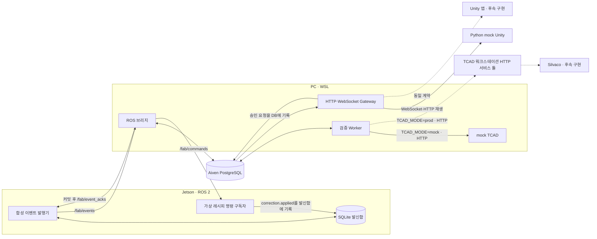

# 가상 팹 TCAD·Unity 연동 경계 정리 설계

작성일: 2026-10-16
상태: 사용자 검토 대기

> 후속 요구 반영: Unity 단계별 검사 요청과 Jetson AOI·진단을 포함한 [공정 검사 확장 설계](../../architecture/process-inspection-orchestration.md)가 추가되었다. 본 문서의 TCAD·Unity 계약 원칙은 유지하며, 신규 이미지·추론·ACK 경계는 확장 설계를 따른다.

## 목적과 성공 기준

현재 실행 환경의 아키텍처·데이터 흐름을 실제 코드와 일치시키고, 별도 TCAD 워크스테이션 및 별도 Unity PC가 준비되었을 때 환경변수로 연결할 수 있는 경계를 만든다. Jetson의 기존 Ubuntu·ROS 2·DDS·네트워크 설정은 변경하지 않는다. 실제 ML, Silvaco 실행, Unity C# 앱은 이번 범위 밖이다.

성공 기준은 다음과 같다.

1. 문서가 WSL Gateway, Jetson, Aiven PostgreSQL, TCAD 워크스테이션, Unity PC의 실제 위치와 실행 여부를 구분한다.
2. 기존 Gateway WebSocket 서버와 TCAD HTTP 클라이언트를 재사용하며, mock과 prod 결과를 혼동하지 않는다.
3. 독립 TCAD HTTP 서비스의 계약 틀은 실행 가능하지만 Silvaco 미연결 상태에서 검증 성공을 반환하지 않는다.
4. Jetson 이벤트의 `/fab/event_acks`를 발행 전 구독으로 관찰하고, 놓친 ACK는 Jetson 발신함과 Aiven 기록으로 확인할 수 있는 재현 가능한 한국어 테스트 절차가 있다.
5. 실제 서비스 URL과 비밀정보는 Git에 저장하지 않고 각 호스트의 `.env`로 설정한다.

## 결정과 대안

선택: Gateway와 mock TCAD를 유지하고, 실제 워크스테이션 배포용 HTTP 서비스 틀을 별도 패키지로 둔다. 기존 `TCAD_MODE=mock|prod`와 모드별 URL이 대상 선택을 담당한다. 이 구조는 mock fixture와 미래 Silvaco 실행 코드를 물리적으로 분리한다. `mock`은 데이터·계산 결과의 출처를 뜻하며, HTTP/WebSocket을 메모리 함수 호출로 대체한다는 뜻이 아니다.

대안 1: 기존 mock TCAD 서버에 prod 로직을 추가한다. 파일 수는 줄지만 테스트 fixture가 실제 계산 경로로 섞일 위험이 있어 선택하지 않는다. 대안 2: TCAD 서비스를 만들기 전까지 문서와 클라이언트만 유지한다. 실제 워크스테이션에서 서버 기동·연결을 미리 검증할 수 없어 선택하지 않는다.

## 현재 구성과 변경 경계

| 위치 | 현재 구성 | 이번 변경 |
|---|---|---|
| Jetson Orin Nano | 합성 로트 발행기, SQLite 발신함, ROS 2 명령 구독자 코드 | 시스템 설정·발행 계약 유지. ACK 관찰/확인 절차 문서화 |
| PC의 WSL | ROS 브리지, Aiven 접속 Gateway HTTP·WebSocket API, 검증 Worker, mock TCAD | 기존 계약 재사용. TCAD prod 연결 설정·실패 응답을 시험 |
| Aiven Cloud | `events`, `integration_runs`, `correction_proposals`, `verification_jobs`, `commands`, `dead_letters` | 영구 기록의 단일 출처. 이번 작업에서 DDL 변경 없음 |
| TCAD 워크스테이션 | 실제 서비스 및 Silvaco 미구현 | 독립 HTTP 서비스 틀을 저장소에 추가. 워크스테이션 배포는 후속 작업 |
| Unity PC | 실제 Unity 앱 미구현 | 이번에는 C# 코드를 만들지 않음. Gateway 계약과 Python mock 수신기를 시험 |

Gateway의 ROS 브리지, HTTP·WebSocket API, 검증 Worker는 한 개의 논리적 Gateway지만 서로 다른 프로세스다. Gateway는 WebSocket **서버**, Unity/mock Unity는 클라이언트다. Jetson과 Unity는 Aiven에 직접 접속하지 않는다.

## 정확한 데이터 흐름

실선은 코드가 있는 경로이며 항상 실행 중임을 뜻하지 않는다. 점선은 후속 실서비스 연동 경계다. 현재 확인된 실제 E2E 범위는 Jetson ROS 이벤트 → WSL 브리지 → Aiven 커밋 → Jetson ACK다. 2026-10-15에 한 실행의 이벤트 6건이 Aiven과 Jetson 발신함에서 확인되었으나, 이를 TCAD·Unity 실연동 성공으로 해석하지 않는다.

### 순서와 보존 규칙

1. Jetson 발행기는 `anomaly.detected`, `correction.proposed`를 로컬 SQLite 발신함에 기록한 후 `/fab/events`로 보낸다. 미확인 건은 2초 간격으로 재발행한다.
2. WSL ROS 브리지는 JSON과 계약을 검증하고 Aiven에 기록한다. 보정안이면 같은 DB 트랜잭션에서 검증 작업을 만든다. 커밋 후에만 `/fab/event_acks`에 `event_id`, `run_id`, `sequence`, `status=committed`를 발행한다. 동일 `event_id` 재전송은 기존 `sequence`로 응답한다.
3. Jetson은 ACK를 받으면 발신함 항목을 완료 표시한다. ACK 토픽은 과거 메시지 조회 저장소가 아니다. 이미 지나간 ACK는 발신함의 `delivered_sequence`와 Aiven `events`로 확인한다.
4. 검증 Worker는 DB 작업을 claim하고 모드에 따라 mock 또는 prod HTTP 대상에 제출·조회한다. 실제 계산 결과의 `result_origin`은 반드시 `prod`여야 한다. 실패·타임아웃은 DB에 재시도 또는 실패 상태로 남긴다.
5. 검증 결과와 `x_current`, `delta_x`, `x_candidate`, `y_verified`는 Aiven에 저장된다. Gateway API는 `GET /api/v1/events` 또는 `WS /api/v1/stream`에서 커서 이후 커밋 이벤트를 Unity 수신자에게 제공한다.
6. 검증 통과만으로 보정은 적용되지 않는다. 사람이 HTTP 승인 API를 호출하면 명령이 DB에 기록되고 브리지가 `/fab/commands`로 보낸다. Jetson 명령 구독자가 `scope=simulation`만 적용한 후 `correction.applied` 이벤트를 발신함에 기록한다. 발행기가 실행 중이어야 이 발신함 항목이 `/fab/events`로 전송된다.

## TCAD 워크스테이션 HTTP 서비스 틀

저장소에 mock 패키지와 분리된 서비스 패키지를 추가한다. 계약 경로는 `POST /api/v1/verifications`, `GET /api/v1/verifications/{job_id}`로 고정한다. `/health/live`는 HTTP 프로세스 생존만 알리고 `/health/ready`는 계산 백엔드 준비 상태를 구분한다. Silvaco 백엔드가 없을 때 POST는 HTTP 503을 반환하고 작업을 접수하지 않는다. 존재하지 않는 작업 조회는 404로 답한다. 성공 `202`와 `result_origin=prod`는 실제 백엔드 어댑터가 영속 작업을 접수하고 결과를 생성할 수 있을 때만 허용한다. 이 단계에서 Silvaco 실행 명령·deck 생성·라이선스 처리·job 영속화는 구현하지 않는다.

Gateway의 기존 `TcadClient`는 동일 계약을 사용한다. `TCAD_MODE=prod`에서는 `TCAD_PROD_URL`이 필수이며 mock으로 자동 전환하지 않는다. 워크스테이션에서 서비스는 해당 호스트의 로컬 설정으로 바인드 주소·포트를 선택한다. 외부 접속·TLS·인증은 실제 서비스 배포 전에 별도로 확정해야 하며 현재 틀을 공용 인터넷에 공개하지 않는다. 실제 URL이나 인증 비밀은 예시 문서에 넣지 않는다.

통신 시험은 제3의 모드 플래그 없이 수행한다. 기존 mock TCAD HTTP 서버를 별도 워크스테이션에서 실행하고 Gateway의 `TCAD_MODE=mock`, `TCAD_MOCK_URL=http://<해당 호스트>:<포트>`로 지정한다. 이때 Gateway→워크스테이션의 실제 네트워크, 실제 HTTP 요청/응답, 작업 ID와 결과 계약을 시험하면서도 결과에는 `result_origin=mock`이 남는다. mock 서버의 바인드 호스트·포트는 워크스테이션의 로컬 환경변수로 지정할 수 있어야 한다. 공용 인터넷에 노출하지 않고 시험망에서만 사용한다.

실제 서비스 틀은 `TCAD_MODE=prod`, `TCAD_PROD_URL`로 접근해 `/health/live`의 네트워크 도달성과 `/health/ready`의 백엔드 미준비를 각각 시험할 수 있다. Silvaco가 없으면 POST는 503이며 검증 E2E 성공이라고 판단하지 않는다. `prod`로 접속한 mock 결과를 진짜 계산으로 승격하는 우회 플래그는 만들지 않는다.

## Unity WebSocket 경계

기존 Gateway가 `/api/v1/stream?run_id=<UUID>&after_sequence=<정수>`를 제공하고 Python mock Unity가 접속해 커서를 로컬에 저장한다. `GET /api/v1/events`는 같은 Aiven 기록의 재생 경로다. `UNITY_MODE=prod`는 실제 Unity 연결 준비를 나타내는 정책 플래그이지 별도 WebSocket 서버를 생성하지 않는다. 이 단계에서 Unity C# 클라이언트, 화면, 이상 주입 UI는 만들지 않는다. 기존 구현에 없는 이상 주입 HTTP API가 있는 것처럼 문서화하지 않는다.

Unity 통신 시험 역시 제3의 플래그 없이 한다. Gateway는 WSL에서 실제 WebSocket 서버를 실행하고 Python mock Unity를 다른 PC에서 실행해 `UNITY_GATEWAY_WS_URL=ws://<Gateway 호스트>:<포트>/api/v1/stream`으로 연결한다. 실제 TCP/WebSocket 연결, 이벤트 JSON, `sequence` 커서 저장과 재접속 재생을 확인한다. `UNITY_MODE=mock`을 유지하므로 mock TCAD 결과를 실제 Unity 운영 승인으로 오인하지 않는다. Unity 앱 준비 후에는 같은 URL·메시지 계약을 사용하며, 배포 시 필요한 보안·접속 설정은 별도로 검토한다.

## 실패와 안전 경계

- Aiven 저장 실패: `committed` ACK를 보내지 않는다. Jetson 발신함이 재시도한다.
- 잘못된 이벤트: 원문을 Aiven `dead_letters`에 보존한 후 식별 가능한 경우 `dead_lettered` ACK를 보낸다.
- TCAD 틀의 503: 검증 Worker가 재시도 상태로 DB에 남기며 `verified`로 바꾸지 않는다.
- Unity 연결 단절: Aiven의 커밋 이벤트는 유지되며 수신자는 마지막 `sequence` 이후 재생한다.
- 명령 승인: 사람 요청과 서명된 시뮬레이션 명령에 한정한다. 실제 장비 제어 없음.

## 문서와 테스트 산출물

1. 현행 아키텍처 문서에서 WSL 내부 PostgreSQL·Windows 로컬 Docker 언급을 Aiven Cloud 기준으로 바로잡고 구성도, 실행 프로세스, mock/prod 경계를 갱신한다. 이전 HTTP 브리지 설계 문서는 역사 문서로 남긴다.
2. 한국어 테스트 runbook에 WSL Gateway, ACK 관찰, Jetson 발행기, Aiven 조회의 정확한 터미널·시작 순서를 적는다. 수동 `ros2 topic pub --once`의 이벤트 유실 가능성과 발행기 SQLite 재전송의 차이를 구분한다.
3. TDD에서 독립 TCAD 서비스의 미준비 응답, 기존 클라이언트의 503 처리, Gateway WebSocket의 DB 커서 재생, ACK 계약과 발신함 완료를 각각 검증한다. 실행 절차는 (a) 한 호스트의 mock 계약 시험, (b) 다른 호스트에 mock TCAD·mock Unity를 띄운 실제 HTTP/WebSocket 통신 시험, (c) prod 서비스 틀의 도달성·미준비 확인을 구분한다. 실제 Silvaco·Unity 앱 연결 여부는 mock 통신 시험 통과와 별도로 보고한다.

## 범위 밖

실제 ML 추론, Silvaco 호출·deck·단위 환산, Unity C# 앱, 새 DB 테이블, 인증 시스템·TLS·DDS 보안 설정, Jetson OS 변경, 자동 승인 및 실제 설비 제어는 이번 단계에서 수행하지 않는다.
