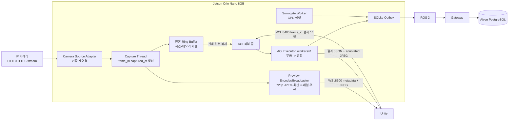

# Jetson 카메라 Preview·Ring Buffer·Unity AOI 요청 설계

- 기준일: 2026-10-20
- 상태: 사용자 승인 설계를 문서화한 구현 전 명세
- 적용 대상: Jetson Orin Nano 8GB, IP 카메라, Unity, AOI Worker
- 기존 계약 유지: AOI 결과 영속화는 `Jetson -> ROS 2 -> Gateway -> Aiven PostgreSQL`

## 1. 목적

Jetson이 IP 카메라의 유일한 소비자가 되어 영상을 지속적으로 취득한다. Unity에는 저부하 Preview만 제공하고, Unity가 실제로 화면에 표시한 프레임을 식별해 AOI 검사를 요청할 수 있어야 한다.

다음 조건을 만족해야 한다.

1. Unity와 Jetson이 카메라에 각각 연결하지 않는다.
2. 24시간 영상을 디스크에 녹화하지 않는다.
3. 최근 원본 프레임만 Jetson RAM의 제한된 Ring Buffer에 둔다.
4. Unity Preview와 AOI 원본 프레임을 `frame_id`로 연결한다.
5. AOI 요청은 비동기 큐에 접수하고 접수·실행·완료 상태를 구분한다.
6. AOI와 서로게이트 ML은 병렬 실행할 수 있어야 한다.
7. 8GB 통합 메모리에서 큐와 버퍼 크기를 제한하고 무제한 병렬 실행을 금지한다.
8. 실제 카메라·Unity가 없어도 mock 입력과 Python 시험 클라이언트로 동일 계약을 검증할 수 있어야 한다.

## 2. 범위와 제외 범위

### 이번 범위

- IP 카메라 인증·재연결을 담당하는 Jetson camera source adapter
- 메모리 상한과 시간 상한을 갖는 원본 프레임 Ring Buffer
- Unity용 WebSocket JPEG Preview
- Unity의 `frame_id` 기반 AOI 요청과 비동기 작업 상태
- 기존 AOI 결과 이미지·ROS 2 outbox·Aiven 저장 흐름 연결
- 카메라, Preview, AOI 큐의 환경변수 계약
- mock/prod 전환과 통신 시험 기준

### 이번 범위에서 제외

- Unity 애플리케이션 구현
- WebRTC 구현
- 24시간 영상 녹화
- 모든 Preview 프레임의 DB 기록
- 카메라 계정정보의 DB·ROS·로그 기록
- 여러 AOI GPU 작업의 동시 실행
- Jetson 전력 모드, 클럭, 팬 정책 변경

WebRTC는 WebSocket Preview의 성능 측정 결과가 요구사항을 충족하지 못할 때 추가하는 후속 adapter다. AOI 요청 계약은 Preview 전송 기술과 독립적으로 유지한다.

## 3. 핵심 결정

### 3.1 카메라 소유권

Jetson의 `CameraCaptureService`만 IP 카메라에 연결한다. Unity는 IP 카메라 주소나 계정정보를 알지 못한다.

Unity가 Ring Buffer를 직접 읽는 구조가 아니다. Ring Buffer는 Jetson 프로세스 내부의 원본 프레임 저장소이고, Unity는 별도로 인코딩된 Preview만 받는다.

### 3.2 카메라 모드

- `CAMERA_MODE=mock`: 지정된 시험 이미지를 결정적인 프레임으로 공급한다.
- `CAMERA_MODE=prod`: 환경변수의 IP 카메라 URI와 인증정보를 사용한다.

HTTP와 HTTPS 주소가 모두 실제 영상 스트림임을 확인했다. 운영 기본값은 HTTPS다. HTTPS 실패 시 HTTP로 자동 하향 전환하지 않는다. HTTP 시험은 `CAMERA_ALLOW_HTTP=true`를 명시한 경우에만 허용한다.

### 3.3 Preview 전송

1차 구현은 별도 WebSocket endpoint에서 JSON 메타데이터와 JPEG 바이너리를 연속 전송한다.

- Preview: `ws://<JETSON_IP>:8500/camera/preview`
- AOI 제어·결과: `ws://<JETSON_IP>:8400/aoi`

Preview 트래픽이 AOI 접수·완료 메시지를 막지 않도록 두 연결을 분리한다.

### 3.4 프레임 선택

Unity는 실제 렌더링한 Preview의 마지막 `frame_id`를 AOI 요청에 넣는다. Jetson은 해당 ID의 원본 프레임을 Ring Buffer에서 조회한다.

- 프레임이 있으면 복사본을 AOI 작업에 고정한다.
- 프레임이 없으면 `stale_frame`으로 거절한다.
- 최신 프레임으로 임의 대체하지 않는다.
- 의도적인 재촬영은 새로운 `request_id`, `job_id`, `attempt`로 요청한다.

## 4. 전체 구조



## 5. 컴포넌트 책임

### 5.1 Camera Source Adapter

- 환경변수에서 URI와 인증정보를 읽는다.
- 연결을 하나만 유지한다.
- 비밀번호가 포함된 URI를 로그에 출력하지 않는다.
- 연결·읽기 timeout과 제한된 재연결 backoff를 적용한다.
- 프레임을 읽지 못한 상태를 정상 프레임으로 간주하지 않는다.
- prod 오류를 mock 결과로 대체하지 않는다.

현재 `capture_camera()`처럼 요청마다 `VideoCapture`를 열고 닫는 방식은 사용하지 않는다. 장시간 유지되는 capture thread가 source를 소유한다.

### 5.2 Capture Thread

- 디코딩된 각 프레임에 증가하는 `frame_id`를 부여한다.
- UTC `captured_at`과 단조 증가 시계 `monotonic_ns`를 함께 기록한다.
- 원본 프레임을 Ring Buffer에 전달한다.
- Preview subscriber 유무와 무관하게 검사 가능한 최신 프레임을 유지한다.
- 소비자가 느려도 카메라 입력을 무한 적재하지 않는다.

### 5.3 Ring Buffer

프레임 레코드의 최소 필드는 다음과 같다.

```text
frame_id
camera_id
captured_at
monotonic_ns
width
height
pixel_format
image
byte_size
```

퇴출 조건은 보관시간과 메모리 상한 중 먼저 도달한 조건이다. AOI 작업에 선택된 프레임은 Ring Buffer 참조에 의존하지 않고 별도 복사본 또는 불변 소유권으로 고정한다.

기본 상한은 2초와 128MiB다. 실제 프레임 크기에 따라 보관 프레임 수가 달라질 수 있으며, 상한을 넘기기 위해 압축되지 않은 이미지를 계속 쌓지 않는다.

### 5.4 Preview Broadcaster

- subscriber가 없으면 JPEG 인코딩과 네트워크 송신을 중지한다.
- Preview는 원본을 덮어쓰지 않고 축소 복사본으로 만든다.
- 각 클라이언트 송신 큐는 최신 프레임 1개만 유지한다.
- 느린 클라이언트에는 중간 Preview 프레임을 버린다.
- Preview frame drop은 AOI 원본 Ring Buffer에 영향을 주지 않는다.
- 인증 완료 전 영상 바이너리를 보내지 않는다.

### 5.5 AOI Dispatcher와 Executor

- WebSocket handler는 요청을 검증하고 큐에 접수한 뒤 즉시 `accepted` 또는 `rejected`를 반환한다.
- 추론을 WebSocket 수신 thread에서 직접 실행하지 않는다.
- AOI executor는 기본 `max_workers=1`이다.
- 하나의 AOI 작업에서는 부품 모델과 결함 모델을 순차 실행한다.
- AOI와 별도 프로세스의 서로게이트 CPU Worker는 병렬 실행할 수 있다.
- 파일 저장·ROS 발행·ACK 수신은 추론 실행과 분리한다.

## 6. 환경변수 계약

실제 비밀값은 Jetson 로컬 `.env`에만 둔다. Git의 `.env.example`과 문서에는 빈 값 또는 placeholder만 둔다.

```dotenv
CAMERA_MODE=prod
CAMERA_ID=aoi-camera-1

CAMERA_SOURCE_URL=https://192.168.10.111:8080
CAMERA_AUTH_MODE=basic
CAMERA_USERNAME=
CAMERA_PASSWORD=
CAMERA_TLS_VERIFY=true
CAMERA_TLS_CA_FILE=
CAMERA_ALLOW_HTTP=false

CAMERA_CONNECT_TIMEOUT_SECONDS=5
CAMERA_READ_TIMEOUT_SECONDS=5
CAMERA_RECONNECT_INTERVAL_SECONDS=3
CAMERA_CAPTURE_FPS=10

CAMERA_RING_BUFFER_SECONDS=2
CAMERA_RING_BUFFER_MAX_MB=128

CAMERA_PREVIEW_TRANSPORT=websocket
CAMERA_PREVIEW_HOST=0.0.0.0
CAMERA_PREVIEW_PORT=8500
CAMERA_PREVIEW_PATH=/camera/preview
CAMERA_PREVIEW_WIDTH=1280
CAMERA_PREVIEW_HEIGHT=720
CAMERA_PREVIEW_FPS=5
CAMERA_PREVIEW_JPEG_QUALITY=75
CAMERA_PREVIEW_MAX_CLIENTS=2
CAMERA_PREVIEW_TOKEN=

AOI_UNITY_WS_HOST=0.0.0.0
AOI_UNITY_WS_PORT=8400
AOI_QUEUE_SIZE=10
AOI_EXECUTOR_WORKERS=1
```

HTTP 시험 시에는 다음 두 값을 함께 명시한다.

```dotenv
CAMERA_SOURCE_URL=http://192.168.10.111:8080
CAMERA_ALLOW_HTTP=true
```

`CAMERA_TLS_VERIFY=false`를 운영 기본값으로 제공하지 않는다. 카메라 인증서가 신뢰되지 않으면 CA 파일을 배포하거나 제한된 시험 설정을 별도로 사용한다.

## 7. WebSocket 계약

### 7.1 Preview 구독

Unity가 `:8500/camera/preview`에 연결한 뒤 첫 텍스트 메시지로 인증과 희망 형식을 보낸다.

```json
{
  "type": "camera.preview.subscribe",
  "schema_version": 1,
  "camera_id": "aoi-camera-1",
  "api_token": "<preview-token>",
  "preferred_width": 1280,
  "preferred_height": 720,
  "preferred_fps": 5
}
```

서버는 허용 범위로 제한한 실제 설정을 응답한다.

```json
{
  "type": "camera.preview.subscribed",
  "schema_version": 1,
  "camera_id": "aoi-camera-1",
  "width": 1280,
  "height": 720,
  "fps": 5,
  "encoding": "jpeg"
}
```

각 프레임은 메타데이터 텍스트와 JPEG 바이너리 한 개의 순서로 전송한다.

```json
{
  "type": "camera.preview.frame",
  "schema_version": 1,
  "camera_id": "aoi-camera-1",
  "frame_id": 184293,
  "captured_at": "2026-10-20T05:30:21.284Z",
  "width": 1280,
  "height": 720,
  "mime_type": "image/jpeg",
  "byte_length": 87342,
  "binary_frame_follows": true
}
```

Unity는 JPEG가 실제 화면에 렌더링된 뒤 해당 `frame_id`를 현재 표시 프레임으로 기록한다.

### 7.2 AOI 요청

Unity는 기존 `:8400/aoi` 연결에 표시 프레임 ID를 포함한 요청을 보낸다.

```json
{
  "type": "aoi.inspection.requested",
  "schema_version": 1,
  "request_id": "126cf723-4812-4e2e-af18-d2af6358057c",
  "job_id": "7c50fcf1-a9d5-44db-859c-aa80cb381779",
  "run_id": "43eb5898-dadb-46b4-accc-b52dd749da10",
  "lot_id": "LOT-001",
  "unit_id": "MOSFET-001",
  "attempt": 1,
  "camera_id": "aoi-camera-1",
  "frame_id": 184293,
  "api_token": "<aoi-token>"
}
```

정상 접수 응답은 완료가 아니라 영속·메모리 접수를 의미한다.

```json
{
  "type": "aoi.inspection.accepted",
  "schema_version": 1,
  "request_id": "126cf723-4812-4e2e-af18-d2af6358057c",
  "job_id": "7c50fcf1-a9d5-44db-859c-aa80cb381779",
  "frame_id": 184293,
  "status": "queued",
  "queue_position": 1
}
```

완료 시 기존 `aoi.inspection.completed` JSON과 annotated JPEG 바이너리를 전달한다. 결과 이벤트는 기존 SQLite outbox와 ROS 2 ACK를 거쳐 Gateway와 Aiven에 저장한다.

### 7.3 거절

요청 프레임이 Ring Buffer에서 퇴출됐을 때:

```json
{
  "type": "aoi.inspection.rejected",
  "schema_version": 1,
  "request_id": "126cf723-4812-4e2e-af18-d2af6358057c",
  "error_code": "stale_frame",
  "requested_frame_id": 184293,
  "oldest_available_frame_id": 184301,
  "latest_available_frame_id": 184310
}
```

큐가 가득 찼을 때:

```json
{
  "type": "aoi.inspection.rejected",
  "schema_version": 1,
  "request_id": "126cf723-4812-4e2e-af18-d2af6358057c",
  "error_code": "queue_full",
  "retry_after_ms": 1000
}
```

## 8. 동시성 모델

하나의 공용 thread pool을 사용하지 않는다.

| 실행 영역 | 기본 동시성 | 설명 |
|---|---:|---|
| Camera capture | thread 1 | 카메라 연결과 최신 프레임 취득 |
| Preview encode/broadcast | worker 1 | subscriber가 있을 때만 실행 |
| AOI GPU executor | worker 1 | 여러 AOI 요청은 큐에서 순차 처리 |
| AOI 내부 모델 | 순차 | 부품 모델 후 결함 모델 |
| Surrogate Worker | 별도 프로세스, worker 1 | CPU 예측, AOI와 병렬 가능 |
| ROS spin/ACK | 별도 thread 또는 process | 추론 중에도 ACK 수신 |
| 파일·네트워크 I/O | 제한된 I/O worker | 추론 callback을 막지 않음 |

CUDA 모델에 `ProcessPoolExecutor`를 사용하지 않는다. 프로세스별 CUDA context와 모델 중복 로드로 8GB 메모리를 소모할 수 있다.

## 9. 저장과 DB

Preview 프레임은 디스크와 DB에 저장하지 않는다. 다음 자료만 저장한다.

- AOI 요청에 고정된 원본 이미지
- 박스와 라벨이 표시된 annotated 이미지
- 검출 클래스, confidence, 원본 기준 bbox
- `camera_id`, `frame_id`, `captured_at`
- 파일명, Jetson 절대경로, SHA-256, 크기, 해상도, MIME
- 요청·작업·실행 모드·모델 버전·threshold

정상 이미지 보관 여부와 보관기간은 별도 저장 정책을 따른다. 저장 실패는 검사 성공으로 처리하지 않는다.

## 10. 오류와 복구

| 오류 | 처리 |
|---|---|
| 카메라 연결 실패 | 상태를 disconnected로 전환하고 제한된 간격으로 재연결 |
| 인증 실패 | 재시도 폭주를 막고 오류 상태·지표만 노출, 비밀번호 로그 금지 |
| 오래된 프레임 | `stale_frame` 거절, 최신 프레임 대체 금지 |
| AOI 큐 포화 | `queue_full`과 재시도 권고 시간 반환 |
| Preview 클라이언트 지연 | 중간 Preview 프레임 폐기 |
| Unity 연결 종료 | AOI 실행과 ROS/Aiven 저장은 계속 진행 |
| 결과 WS 전송 실패 | 결과 outbox·DB 저장 유지, Unity는 job/event 조회로 복구 |
| Jetson 재시작 | RAM Ring Buffer는 복구하지 않음. 이미 접수·고정한 작업만 영속 상태에 따라 복구 |
| prod 모델/카메라 실패 | mock으로 자동 대체 금지 |

## 11. 보안

- 카메라 계정정보는 Jetson 로컬 `.env`에만 저장한다.
- `.env`, `.env.*`는 Git에서 제외하고 `.env.example`만 관리한다.
- URI, 로그, 예외, ROS, DB에 카메라 비밀번호를 포함하지 않는다.
- Unity는 카메라 계정정보를 받지 않는다.
- Preview token과 AOI token은 분리한다.
- 인증 실패와 과도한 연결 요청에 연결 제한을 적용한다.
- 운영 HTTPS는 인증서 검증을 기본으로 한다.
- 대화나 시험 로그에 노출된 기존 비밀번호는 운영 적용 전에 교체한다.

## 12. 관측성과 자원 보호

최소 지표:

- 카메라 연결 상태와 재연결 횟수
- capture FPS, Preview FPS, drop 수
- Ring Buffer 프레임 수·바이트·최고 사용량
- Preview subscriber 수와 느린 클라이언트 drop 수
- AOI 큐 길이·대기시간·실행시간·실패 수
- stale frame과 queue full 횟수
- 모델별 추론시간

Jetson 검증에서는 설정을 바꾸지 않고 `tegrastats`와 `free -h`로 다음 상태를 비교한다.

1. idle
2. camera capture
3. capture + Preview
4. capture + Preview + AOI
5. 위 상태 + Surrogate 병렬 실행

메모리 누수, OOM, 지속적인 thermal throttling, 무한 큐 증가가 없어야 한다.

## 13. 시험 전략과 합격 기준

### 단위 시험

- Ring Buffer의 시간·메모리 퇴출
- frame ID 단조 증가와 조회
- 선택 프레임의 불변 고정
- HTTP 비허용, TLS 설정, 비밀값 redaction
- Preview 구독 인증과 크기/FPS 제한
- 느린 클라이언트 최신 프레임 우선
- stale frame, queue full 계약
- 동일 request/job 중복과 본문 충돌

### 통합 시험

- mock frame -> Preview mock Unity -> frame ID AOI 요청 -> annotated JPEG
- Preview 연결 종료 후 AOI/ROS 저장 지속
- AOI 실행 중 Surrogate 응답 완료
- AOI 요청 여러 건의 순차 처리
- 카메라 단절·재연결 중 상태 메시지
- 결과 이벤트 ROS 발행, Gateway Aiven 저장, ACK 후 outbox 제거

### 실제 장비 시험

- HTTPS 카메라 연결과 인증서 검증
- Unity PC에서 Preview 표시와 표시 frame ID 요청
- 요청 frame ID와 저장된 원본·annotated 결과 일치
- 30분 이상 Preview와 반복 AOI에서 RAM 증가 추세 없음
- AOI와 Surrogate 동시 실행 시 프로세스 생존과 응답시간 기록

1차 합격은 기능 성공뿐 아니라 자원 수치를 기록하는 것이다. 측정 결과가 Preview 요구 지연이나 발열 기준을 충족하지 못하면 Preview adapter만 WebRTC로 교체한다.

## 14. 구현 경계

기존 `aoi_unity.py`가 fixture를 직접 읽고 동기 추론하는 경로를 다음 책임으로 분리해야 한다.

- `camera_source.py`: mock/prod source adapter
- `camera_buffer.py`: frame record와 bounded Ring Buffer
- `camera_service.py`: capture lifecycle과 reconnect
- `camera_preview.py`: Preview WebSocket과 per-client latest-only queue
- `aoi_dispatcher.py`: 접수·중복 제거·queue·executor·상태
- 기존 `aoi_pipeline.py`: 순수 이미지 추론과 annotation 유지
- 기존 outbox/ROS bridge: 중앙 DB 영속화 유지

구현 파일명은 상세 계획 단계에서 현재 패키지 구조에 맞춰 확정한다. 이 명세는 Unity, ROS 2, Gateway의 기존 외부 계약을 불필요하게 변경하지 않는 것을 우선한다.
