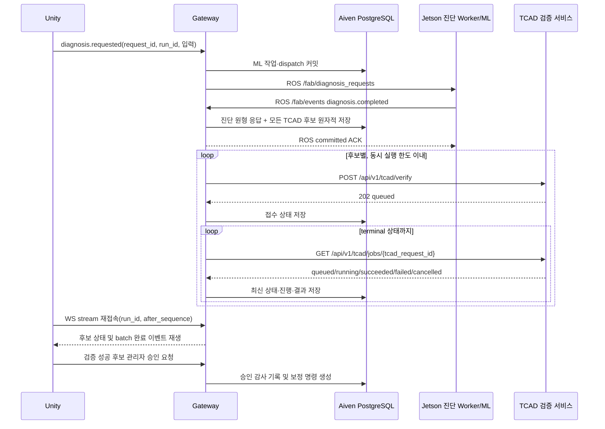

# TCAD 검증 서비스 비동기 큐 통합 설계

작성일: 2026-10-21  
대상: WSL Gateway, Aiven PostgreSQL, 외부 TCAD 검증 HTTP 서비스, Unity

## 1. 목적과 성공 기준

Jetson 진단 모델이 생성한 보정 후보를 Gateway가 영속 큐로 관리하고, 별도
워크스테이션의 TCAD 검증 서비스에 순차 전송한다. TCAD 작업은 최대 90분 이상
걸릴 수 있으므로 Unity WebSocket이나 HTTP 요청을 열린 상태로 기다리지 않는다.
Gateway와 TCAD 서비스가 각각 보유한 큐를 구분하고, 모든 후보·상태·결과를 Aiven
PostgreSQL에 보존한다.

성공 기준은 다음과 같다.

- `compensation.route=tcad_verify`인 유효한 진단 결과의 모든 후보가 DB에 저장된다.
- 같은 진단 결과를 재수신해도 후보별 TCAD 작업은 중복 생성되지 않는다.
- Gateway는 기본적으로 TCAD 작업을 한 번에 하나만 제출·조회한다.
- 외부 서비스의 `queued`, `running`, `succeeded`, `failed`, `cancelled` 상태를
  작업별로 추적한다.
- Unity는 최초 요청 연결과 무관하게 커밋 이벤트를 재생해 후보별 진행 상태와 최종
  결과를 확인한다.
- TCAD 검증 성공 후에도 관리자 승인 전에는 보정 명령을 생성하지 않는다.
- mock과 prod가 같은 HTTP 계약을 사용하고 환경변수만으로 전환된다.

## 2. 확정 정책

### 2.1 후보와 동시 실행

`tcad_proposal.candidates`의 유효한 후보를 모두 Gateway DB 큐에 저장한다. 후보를
저장 단계에서 하나로 축소하지 않는다. TCAD 서버로 보내는 동시 작업 수는
`TCAD_MAX_CONCURRENT_JOBS`로 제한하며 기본값은 `1`이다. 따라서 후보가 여러 개면
DB에는 즉시 모두 보이지만 실제 TCAD 실행은 순차적으로 진행된다.

Gateway 큐와 TCAD 서비스 큐는 서로 다른 계층이다.

- Gateway 큐: 후보 영속화, 중복 방지, 제출 순서, 재시도, 마감시간 관리
- TCAD 서비스 큐: 이미 접수된 Silvaco 작업의 실행 순서와 진행 상태 관리

Gateway가 동시 실행 한도를 셀 때 외부 상태 `queued`와 `running`을 모두 활성
작업으로 간주한다. 활성 작업 수가 한도에 도달하면 다음 후보를 외부 서비스에
제출하지 않는다.

### 2.2 승인과 적용

모든 보정은 TCAD 검증과 관리자 승인을 거친다. 모델의 `high_confidence`는 표시와
우선순위 참고 정보일 뿐 TCAD를 생략하는 근거가 아니다. 관리자는 TCAD 검증에
성공한 후보 중 하나를 선택해 승인한다. 승인되지 않은 후보와 실패·취소 후보는
보정 명령으로 변환하지 않는다.

### 2.3 초기 라우팅 기준

첫 구현은 다음 조건을 모두 만족할 때만 후보 큐를 생성한다.

1. 진단 응답 계약 검증 성공
2. `status=succeeded`
3. `anomaly_detected=true`
4. `compensation.route=tcad_verify`
5. `tcad_proposal`이 존재하고 후보가 한 개 이상
6. `TCAD_AUTO_SUBMIT_ENABLED=true`

향후 수치 임계값 정책은 별도 버전의 정책 모듈로 추가한다. 현재 모델 응답에 없는
값을 추정하거나 Unity가 임계값을 대신 판단하지 않는다. 라우팅 당시의 계약 버전,
`threshold_evidence`, `thresholds`, `confidence_blockers`와 정책 버전을 원형 JSON에
보존한다.

## 3. 식별자와 상관관계

전체 흐름에 하나의 `request_id`를 재사용하지 않는다. 각 식별자의 수명과 책임은
다음과 같다.

| 식별자 | 의미 |
|---|---|
| `run_id` | Unity 요청부터 모델·TCAD·승인·적용까지 한 공정 실행을 연결하는 최상위 키 |
| `request_id` | Unity가 보낸 개별 진단 요청 식별자 |
| `job_id` | Gateway 내부 ML 작업 식별자 |
| `proposal_id` | 한 진단 결과에서 생성된 보정 제안 묶음 식별자 |
| `tcad_request_id` | 후보 하나의 TCAD 검증 작업 식별자이자 외부 TCAD 조회 키 |

`tcad_request_id`는 `proposal_id`와 후보 순번으로 결정론적으로 생성한다.

```text
UUIDv5(TCAD_NAMESPACE, "<proposal_id>:tcad-candidate:<candidate_index>")
```

같은 진단 이벤트가 ROS 재전송이나 Gateway 재시작으로 다시 처리되어도 동일한
`tcad_request_id`가 생성된다. 외부 POST의 `request_id`와
`GET /api/v1/tcad/jobs/{request_id}`의 경로 값에는 이 식별자를 사용한다. Unity의
원래 `request_id`를 외부 TCAD 작업 키로 재사용하지 않는다.

## 4. 구성요소와 책임

| 구성요소 | 책임 |
|---|---|
| Unity | 진단 요청, 커밋 이벤트 표시·재생, 검증된 후보의 관리자 승인 요청 |
| Gateway 진단 수신기 | 모델 응답 계약 검증, 원형 응답 저장, 라우팅 조건 평가 |
| TCAD 후보 저장소 | 모든 후보와 정책 스냅샷을 원자적으로 저장, 중복 방지 |
| TCAD 검증 Worker | 동시 실행 한도 적용, POST 접수, GET 조회, 재시도·마감 처리 |
| TCAD HTTP Client | 인증 헤더, 요청·응답 계약 및 식별자 검증 |
| 외부 TCAD 서비스 | 요청 접수, 자체 큐와 Silvaco 실행, 상태·결과 제공 |
| Gateway 이벤트 저장소 | 상태 변화 이벤트를 Aiven에 커밋하고 Unity 재생에 제공 |

Unity는 TCAD 서비스에 직접 접속하거나 TCAD 상태를 직접 폴링하지 않는다. Gateway가
라우팅·폴링·영속화를 전담하며 Aiven PostgreSQL이 진행 상태의 단일 기준이다.

## 5. 데이터 흐름



진단 원형 응답과 후보 큐 생성은 같은 DB 트랜잭션으로 처리한다. DB 커밋 전에 ROS
`committed` ACK를 보내지 않는다.

## 6. 외부 TCAD HTTP 계약

### 6.1 접수

```http
POST /api/v1/tcad/verify
X-Fab-Token: <TCAD_API_TOKEN>
Content-Type: application/json
```

```json
{
  "request_id": "<tcad_request_id>",
  "job_id": "<gateway_ml_job_id>",
  "run_id": "<run_id>",
  "lot_id": "LOT-001",
  "process_parameters": {
    "body_dose": 7700000000000.0,
    "epi_doping": 17000000000000000.0,
    "oxide_thickness": 0.06
  },
  "requested_outputs": ["vth", "gm", "id_on", "bv"],
  "predicted_outputs": {
    "vth": 2.8,
    "gm": 120.0,
    "id_on": 260.0,
    "bv": 42.0
  },
  "options": {
    "timeout_seconds": 5400
  }
}
```

`body_dose` 단위는 `cm^-2`, `epi_doping`은 `cm^-3`,
`oxide_thickness`는 `um`이다. `requested_outputs` 기본값은 네 출력 전체다. BV를
제외하는 결정은 정책이 명시할 때만 허용하며 첫 구현에서는 네 출력을 요청한다.

정상 접수는 HTTP 202와 다음 필드를 반환한다.

```json
{
  "request_id": "<tcad_request_id>",
  "status": "queued",
  "queue_position": 1,
  "estimated_seconds": 5400,
  "accepted_at": "2026-10-21T12:00:00Z"
}
```

응답 `request_id`가 요청과 다르면 계약 오류로 처리한다.

### 6.2 조회

```http
GET /api/v1/tcad/jobs/{tcad_request_id}
X-Fab-Token: <TCAD_API_TOKEN>
```

허용 상태는 다음과 같다.

- `queued`: `queue_position`, `estimated_seconds`
- `running`: `progress.stage`, `progress.stages`
- `succeeded`: `result_payload`, `metadata`, 선택적 `prediction_error`
- `failed`: `error_code`, `error_message`, `result_payload=null`
- `cancelled`: `cancelled_at`

성공 결과에서 `result_payload`는 요청한 출력의 `vth(V)`, `gm(uS/um)`,
`id_on(uA/um)`, `bv(V)`를 담는다. Gateway는 요청 식별자와 상태를 엄격히
검증하지만 서비스가 제공하는 추가 `metadata`와 경고는 원형으로 보존한다.

### 6.3 인증과 비밀정보

`TCAD_API_TOKEN`은 POST와 GET 모두 `X-Fab-Token` 헤더로 전송한다. 토큰을 요청
JSON, DB, 이벤트, 예외 메시지 또는 로그에 저장하지 않는다. 빈 토큰은 mock에서만
허용하고 prod에서는 시작 시 실패한다. 실서비스는 HTTPS를 권장하되 현재 폐쇄망의
HTTP URL도 환경변수로 허용한다.

## 7. DB 설계

진단 결과 아래에 제안 묶음과 후보별 검증 작업을 둔다. 기존 단일 후보용
`verification_jobs`는 레거시 이벤트 호환을 위해 유지하되 신규 진단 경로에서 새
작업을 기록하지 않는다.

### 7.1 `tcad_proposal_groups`

- `proposal_id` UUID PK
- `diagnosis_job_id`, `source_event_id`, `run_id`
- `model_contract_version`, `policy_version`
- `routing_snapshot` JSONB
- `candidate_count`, `terminal_count`
- `status`: `queued|running|completed|failed|cancelled|review_required`
- 생성·갱신 시각
- `source_event_id` UNIQUE로 진단 결과 중복 처리를 방지

### 7.2 `tcad_verification_candidates`

- `tcad_request_id` UUID PK
- `proposal_id` FK, `candidate_index`
- `process_parameters`, `predicted_outputs`, `requested_outputs` JSONB
- `request_body`, `acceptance_body`, `latest_response_body` JSONB
- `status`: `pending|submitting|queued|running|succeeded|failed|cancelled|expired`
- `queue_position`, `progress`, `result_payload`, `prediction_error`, `metadata` JSONB
- `attempt_count`, `next_attempt_at`, `lease_token`, `lease_until`
- `accepted_at`, `started_at`, `completed_at`, `deadline_at`
- `last_error_code`, `last_error_message`
- 생성·갱신 시각
- UNIQUE(`proposal_id`, `candidate_index`)

Worker claim은 `FOR UPDATE SKIP LOCKED`와 lease를 사용한다. `pending` 후보는 활성
외부 작업 수가 동시 실행 한도보다 작을 때만 `submitting`으로 claim한다. 이미 외부에
접수된 `queued`·`running` 후보의 조회는 새 후보 제출보다 우선한다.

### 7.3 승인 연결

관리자 승인 요청은 `proposal_id`와 `tcad_request_id`를 모두 요구한다. Gateway는
해당 후보가 `succeeded`인지, 같은 제안 묶음에 속하는지, 이미 다른 후보가
승인되었는지 검사한다. 승인된 후보의 공정 변수를 기존 `correction_proposals` 및
명령 계약으로 변환하며 승인자·승인시각·선택 후보를 감사 기록에 남긴다.

## 8. 상태·재시도·마감 정책

- HTTP 연결 timeout: `TCAD_CONNECT_TIMEOUT_SECONDS`, 기본 5초
- 한 HTTP 요청 timeout: `TCAD_REQUEST_TIMEOUT_SECONDS`, 기본 30초
- 상태 조회 간격: `TCAD_POLL_INTERVAL_SECONDS`, 기본 10초
- 후보 전체 마감: `TCAD_JOB_DEADLINE_SECONDS`, 기본 6000초
- 동시 외부 작업: `TCAD_MAX_CONCURRENT_JOBS`, 기본 1

네트워크 오류와 HTTP 5xx는 지수형 backoff로 재시도한다. HTTP 400, 401, 403,
422와 계약 위반은 terminal `failed`로 처리한다. 동일 `tcad_request_id` 제출 중
충돌 응답을 받으면 조회로 전환해 외부 작업 존재 여부를 확인한다. 외부 `failed`와
`cancelled`는 자동으로 새 식별자를 만들어 재제출하지 않는다. 마감시간을 넘긴
작업은 `expired`로 표시하고 관리자에게 재시도 결정을 맡긴다.

진행 poll마다 이벤트를 만들지 않는다. 상태, stage 또는 terminal 결과가 바뀔 때만
이벤트를 추가하고 최신 progress 자체는 후보 행에 갱신한다. 이 규칙은 장시간 작업의
이벤트·Unity 트래픽 폭증을 방지한다.

## 9. Unity 전달 계약

Unity는 기존 Gateway stream의 `run_id`와 `sequence` 커서를 사용한다. 장시간 TCAD
검증 동안 연결을 유지할 필요가 없으며 재접속 시 누락 이벤트를 재생한다.

Gateway가 생성하는 이벤트는 다음과 같다.

- `tcad.verification.candidate_queued`
- `tcad.verification.candidate_running`
- `tcad.verification.candidate_succeeded`
- `tcad.verification.candidate_failed`
- `tcad.verification.candidate_cancelled`
- `tcad.verification.batch_completed`
- `tcad.verification.review_required`

모든 후보 이벤트에는 `run_id`, 원래 진단 `request_id`, `job_id`, `proposal_id`,
`tcad_request_id`, `candidate_index`, `status`를 포함한다. terminal 이벤트에는 결과
또는 오류를 추가한다. `batch_completed`에는 후보별 요약과 성공 후보 수를 포함한다.
토큰과 외부 endpoint URL은 전달하지 않는다.

## 10. 환경변수

```dotenv
TCAD_MODE=prod
TCAD_PROD_URL=http://<tcad-host>:<port>
TCAD_API_TOKEN=<secret>
TCAD_AUTO_SUBMIT_ENABLED=true
TCAD_MAX_CONCURRENT_JOBS=1
TCAD_CONNECT_TIMEOUT_SECONDS=5
TCAD_REQUEST_TIMEOUT_SECONDS=30
TCAD_POLL_INTERVAL_SECONDS=10
TCAD_JOB_DEADLINE_SECONDS=6000
TCAD_POLICY_VERSION=route-v1
```

mock은 `TCAD_MODE=mock`, `TCAD_MOCK_URL`을 사용하고 나머지 계약·큐·DB 흐름은
prod와 동일하게 실행한다. `.env.example`에는 값의 의미만 적고 실제 토큰은 넣지
않는다.

## 11. 테스트 전략

1. 계약 단위 테스트: POST/GET 경로, 헤더, 202, 다섯 상태, 식별자 불일치,
   추가 metadata 보존
2. 라우팅 단위 테스트: route 조합, 자동 제출 플래그, 후보 유효성, 재수신 중복 방지
3. DB 통합 테스트: 진단 결과와 모든 후보의 원자적 저장, 결정론적 UUID,
   `SKIP LOCKED` claim
4. Worker 테스트: 동시 실행 1, 조회 우선, 재시도, terminal 오류, deadline, 재시작 복구
5. mock HTTP 통합 테스트: 여러 후보가 순차 접수되고 각 상태와 batch 결과가 저장됨
6. Unity stream 테스트: 연결을 끊었다가 sequence 이후 후보·batch 이벤트 재생
7. prod 사전 시험: `/health/ready`, 잘못된 토큰 거절, 학습 영역 입력으로 한 작업 접수·조회

TDD는 실패 테스트를 먼저 추가한 뒤 계약 클라이언트, 마이그레이션·저장소,
라우팅, Worker, mock 서비스, API 문서 순으로 구현한다. Aiven 적용 전 동일 PostgreSQL
버전의 테스트 DB에서 마이그레이션과 rollback 불필요성, 기존 데이터 호환을 확인한다.

## 12. 범위 밖

- Silvaco deck 생성과 TCAD 내부 계산 구현
- 모델의 보정 후보 생성 로직 변경
- 수치 기반 자동 라우팅 임계값 결정
- TCAD 검증 또는 관리자 승인을 생략하는 자동 적용
- Unity C# 화면 구현
- 외부 `cancel` API 호출
- TCAD 결과로 모델을 자동 재학습하는 기능
